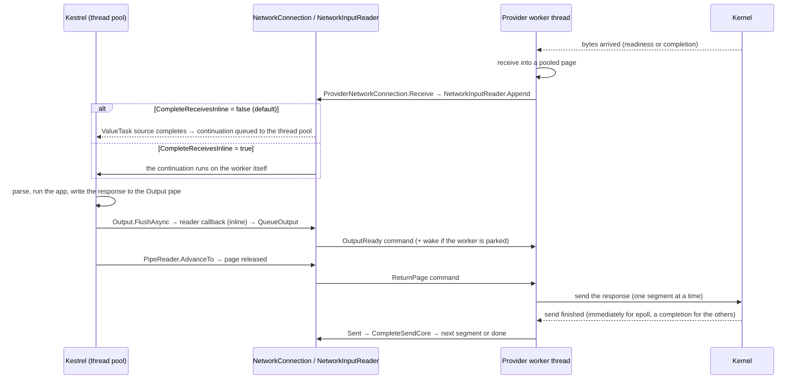
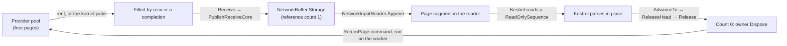

# Project Bedrock: how the four providers work (deep dive)

This is the implementation map for [Bedrock.md](https://github.com/DeagleGross/aspnetcore/blob/dmkorolev/project-bedrock/src/Servers/Kestrel/Transport.Networking/Bedrock.md). It shows where each provider does its I/O (the submission and completion queues for io_uring and RIO, the read and write calls for epoll and IOCP), how receive pages and output blocks are owned and moved, how a finished operation gets back to the thread pool, and what the 2026-11-13 implementation sweep found. It covers the main pieces only, not every option. The measurements are in Bedrock.md, and the public API is in [Bedrock-API.md](https://github.com/DeagleGross/aspnetcore/blob/dmkorolev/project-bedrock/src/Servers/Kestrel/Transport.Networking/Bedrock-API.md).

Every code link points at the branch `dmkorolev/project-bedrock`, so it follows the branch as it moves. Line anchors are accurate for commit `858379c282`; when the code changes they can drift by a few lines, so each link names the symbol to search for.

## What is on the Bedrock path

| Folder | What it is | On the Bedrock path |
| --- | --- | --- |
| [`Primitives/src`](https://github.com/DeagleGross/aspnetcore/tree/dmkorolev/project-bedrock/src/Servers/Kestrel/Transport.Networking/Primitives/src) | `NetworkConnection`, `NetworkInputReader`, buffers, the engine and listener abstractions | Yes. The provider-independent receive and send logic lives here. |
| [`src/Bedrock`](https://github.com/DeagleGross/aspnetcore/tree/dmkorolev/project-bedrock/src/Servers/Kestrel/Transport.Networking/src/Bedrock) | `NetworkTransportFactory`, `ConnectionContextStream`, DI and `SocketsHttpHandler` extensions | Yes. |
| [`src/Shared`](https://github.com/DeagleGross/aspnetcore/tree/dmkorolev/project-bedrock/src/Servers/Kestrel/Transport.Networking/src/Shared) | Engine factory, `ProviderNetworkConnection` (the glue between a provider and `NetworkConnection`), Kestrel adapter | Yes. |
| [`src/Epoll`](https://github.com/DeagleGross/aspnetcore/tree/dmkorolev/project-bedrock/src/Servers/Kestrel/Transport.Networking/src/Epoll) | Linux epoll provider and its C shim | Yes. |
| [`src/IoUringTcp`](https://github.com/DeagleGross/aspnetcore/tree/dmkorolev/project-bedrock/src/Servers/Kestrel/Transport.Networking/src/IoUringTcp) | Linux io_uring provider and its C shim (liburing) | Yes. |
| [`src/Windows`](https://github.com/DeagleGross/aspnetcore/tree/dmkorolev/project-bedrock/src/Servers/Kestrel/Transport.Networking/src/Windows) and [`src/Rio`](https://github.com/DeagleGross/aspnetcore/tree/dmkorolev/project-bedrock/src/Servers/Kestrel/Transport.Networking/src/Rio) | IOCP and RIO providers (one worker class serves both) and the RIO function table | Yes. |
| `src/IoUring`, `src/IoUringBio`, `src/IoUringTls` | The first io_uring experiment (over a `Socket`, September), and the TLS and BIO layers of the later one | No. Reached only through the older `UseIoUring*` host-builder extensions. |
| `Connection.cs` in `Epoll`, `IoUringTcp` and `Windows` | The pre-Bedrock connection classes that publish a Kestrel `ConnectionContext` directly | No. They are used when a listener is created with `shared: false`; Bedrock always uses `ProviderNetworkConnection`. |

## One request, end to end

The same sequence holds for all four providers. Only the middle part (how the worker learns that bytes arrived, and how it sends) differs.

The pieces, in the order a request meets them:

1. **Bind and accept.** Kestrel calls [`NetworkTransportFactory.BindAsync`](https://github.com/DeagleGross/aspnetcore/blob/dmkorolev/project-bedrock/src/Servers/Kestrel/Transport.Networking/src/Bedrock/NetworkTransportFactory.cs#L40) (only after [`CanBind`](https://github.com/DeagleGross/aspnetcore/blob/dmkorolev/project-bedrock/src/Servers/Kestrel/Transport.Networking/src/Bedrock/NetworkTransportFactory.cs#L37) accepted the endpoint), which reaches [`ProviderEngine.ListenAsync`](https://github.com/DeagleGross/aspnetcore/blob/dmkorolev/project-bedrock/src/Servers/Kestrel/Transport.Networking/src/Shared/NetworkEngineFactory.cs#L117) and starts the provider's workers. [`ProviderListener.AcceptAsync`](https://github.com/DeagleGross/aspnetcore/blob/dmkorolev/project-bedrock/src/Servers/Kestrel/Transport.Networking/src/Shared/NetworkEngineFactory.cs#L188) hands out connections that workers published, and applies the engine's `CompleteReceivesInline` default ([line 202](https://github.com/DeagleGross/aspnetcore/blob/dmkorolev/project-bedrock/src/Servers/Kestrel/Transport.Networking/src/Shared/NetworkEngineFactory.cs#L202)). [`KestrelConnectionContext`](https://github.com/DeagleGross/aspnetcore/blob/dmkorolev/project-bedrock/src/Servers/Kestrel/Transport.Networking/src/Shared/KestrelAdapters.cs#L19) wraps the connection and sets `Transport = network.AsDuplexPipe()` ([line 32](https://github.com/DeagleGross/aspnetcore/blob/dmkorolev/project-bedrock/src/Servers/Kestrel/Transport.Networking/src/Shared/KestrelAdapters.cs#L32)).
2. **A receive is published.** The worker calls one of the three [`ProviderNetworkConnection.Receive`](https://github.com/DeagleGross/aspnetcore/blob/dmkorolev/project-bedrock/src/Servers/Kestrel/Transport.Networking/src/Shared/ProviderNetworkConnection.cs#L54) overloads (page id, native pointer, or `IMemoryOwner`), which wrap the page in an owner whose `Dispose` returns it to the provider ([`ReturnedMemory`](https://github.com/DeagleGross/aspnetcore/blob/dmkorolev/project-bedrock/src/Servers/Kestrel/Transport.Networking/src/Shared/ProviderNetworkConnection.cs#L215)). That reaches [`PublishReceiveCore`](https://github.com/DeagleGross/aspnetcore/blob/dmkorolev/project-bedrock/src/Servers/Kestrel/Transport.Networking/Primitives/src/NetworkConnection.cs#L298) and [`NetworkInputReader.Append`](https://github.com/DeagleGross/aspnetcore/blob/dmkorolev/project-bedrock/src/Servers/Kestrel/Transport.Networking/Primitives/src/NetworkInputReader.cs#L54), which links the page into a segment list and completes a waiting read.
3. **The hop to the thread pool.** The reader is a `ManualResetValueTaskSourceCore` created with [`RunContinuationsAsynchronously = true`](https://github.com/DeagleGross/aspnetcore/blob/dmkorolev/project-bedrock/src/Servers/Kestrel/Transport.Networking/Primitives/src/NetworkInputReader.cs#L18). [`SetPending`](https://github.com/DeagleGross/aspnetcore/blob/dmkorolev/project-bedrock/src/Servers/Kestrel/Transport.Networking/Primitives/src/NetworkInputReader.cs#L122) completes it after the reader's lock is released, and the runtime then queues Kestrel's continuation to the thread pool. [`CompleteInline`](https://github.com/DeagleGross/aspnetcore/blob/dmkorolev/project-bedrock/src/Servers/Kestrel/Transport.Networking/Primitives/src/NetworkInputReader.cs#L24) (set through [`NetworkConnection.CompleteReceivesInline`](https://github.com/DeagleGross/aspnetcore/blob/dmkorolev/project-bedrock/src/Servers/Kestrel/Transport.Networking/Primitives/src/NetworkConnection.cs#L87)) flips that flag so the continuation runs on the worker. This is the only place a receive crosses from the worker to the thread pool.
4. **The page goes back.** Kestrel's `AdvanceTo` ([`NetworkInputReader.AdvanceTo`](https://github.com/DeagleGross/aspnetcore/blob/dmkorolev/project-bedrock/src/Servers/Kestrel/Transport.Networking/Primitives/src/NetworkInputReader.cs#L243), [`ReleaseHead`](https://github.com/DeagleGross/aspnetcore/blob/dmkorolev/project-bedrock/src/Servers/Kestrel/Transport.Networking/Primitives/src/NetworkInputReader.cs#L278)) releases the owner, and each provider's driver turns that into a `ReturnPage` command for the owning worker: [`EpollDriver.Return`](https://github.com/DeagleGross/aspnetcore/blob/dmkorolev/project-bedrock/src/Servers/Kestrel/Transport.Networking/src/Shared/ProviderNetworkConnection.cs#L143), [`RingDriver.Return`](https://github.com/DeagleGross/aspnetcore/blob/dmkorolev/project-bedrock/src/Servers/Kestrel/Transport.Networking/src/Shared/ProviderNetworkConnection.cs#L158), [`WindowsDriver.Return`](https://github.com/DeagleGross/aspnetcore/blob/dmkorolev/project-bedrock/src/Servers/Kestrel/Transport.Networking/src/Shared/ProviderNetworkConnection.cs#L199).
5. **The response is written.** Kestrel writes to the connection's output `Pipe`, created with `readerScheduler: PipeScheduler.Inline` and `writerScheduler: PipeScheduler.ThreadPool` ([`NetworkConnection` constructor](https://github.com/DeagleGross/aspnetcore/blob/dmkorolev/project-bedrock/src/Servers/Kestrel/Transport.Networking/Primitives/src/NetworkConnection.cs#L46)). `FlushAsync` runs the pipe's reader callback inline on the flushing thread, and that callback only calls [`QueueOutput`](https://github.com/DeagleGross/aspnetcore/blob/dmkorolev/project-bedrock/src/Servers/Kestrel/Transport.Networking/Primitives/src/NetworkConnection.cs#L205) → [`ScheduleOutputCore`](https://github.com/DeagleGross/aspnetcore/blob/dmkorolev/project-bedrock/src/Servers/Kestrel/Transport.Networking/src/Shared/ProviderNetworkConnection.cs#L92) → the driver's `Schedule`, which enqueues an `OutputReady` command to the worker ([epoll](https://github.com/DeagleGross/aspnetcore/blob/dmkorolev/project-bedrock/src/Servers/Kestrel/Transport.Networking/src/Shared/ProviderNetworkConnection.cs#L135), [io_uring](https://github.com/DeagleGross/aspnetcore/blob/dmkorolev/project-bedrock/src/Servers/Kestrel/Transport.Networking/src/Shared/ProviderNetworkConnection.cs#L150), [Windows](https://github.com/DeagleGross/aspnetcore/blob/dmkorolev/project-bedrock/src/Servers/Kestrel/Transport.Networking/src/Shared/ProviderNetworkConnection.cs#L169)). No socket call happens on the thread pool.
6. **The worker sends.** The `OutputReady` command runs [`PumpOutputCore`](https://github.com/DeagleGross/aspnetcore/blob/dmkorolev/project-bedrock/src/Servers/Kestrel/Transport.Networking/Primitives/src/NetworkConnection.cs#L362) on the worker. It takes the pipe's buffered bytes and submits one segment at a time through [`SubmitSendCore`](https://github.com/DeagleGross/aspnetcore/blob/dmkorolev/project-bedrock/src/Servers/Kestrel/Transport.Networking/Primitives/src/NetworkConnection.cs#L454) → `driver.Send`. When the provider reports the segment finished it calls [`ProviderNetworkConnection.Sent`](https://github.com/DeagleGross/aspnetcore/blob/dmkorolev/project-bedrock/src/Servers/Kestrel/Transport.Networking/src/Shared/ProviderNetworkConnection.cs#L69) → [`CompleteSendCore`](https://github.com/DeagleGross/aspnetcore/blob/dmkorolev/project-bedrock/src/Servers/Kestrel/Transport.Networking/Primitives/src/NetworkConnection.cs#L315), and the pump continues with the next segment. The pinned address of each segment stays valid until that completion, which is why a segment is only released after `Sent`.
7. **Close.** [`CompleteCloseCore`](https://github.com/DeagleGross/aspnetcore/blob/dmkorolev/project-bedrock/src/Servers/Kestrel/Transport.Networking/Primitives/src/NetworkConnection.cs#L335) runs when the provider has no operation left that references the socket or its memory; it signals `ConnectionClosed` from a thread-pool work item. [`DisposeCore`](https://github.com/DeagleGross/aspnetcore/blob/dmkorolev/project-bedrock/src/Servers/Kestrel/Transport.Networking/Primitives/src/NetworkConnection.cs#L257) waits for output to stop, the native close, and every retained receive page before the provider forgets the connection.

**The rule all providers follow:** every field of a connection is touched only by its worker thread. Any other thread (Kestrel, the thread pool) communicates with the worker by enqueuing a command and, only if the worker is parked, waking it. Each provider's `Enqueue` joins a wake that is already pending, so a busy worker is woken at most once per drain ([epoll](https://github.com/DeagleGross/aspnetcore/blob/dmkorolev/project-bedrock/src/Servers/Kestrel/Transport.Networking/src/Epoll/EpollWorker.cs#L104), [io_uring](https://github.com/DeagleGross/aspnetcore/blob/dmkorolev/project-bedrock/src/Servers/Kestrel/Transport.Networking/src/IoUringTcp/Engine.cs#L116), [Windows](https://github.com/DeagleGross/aspnetcore/blob/dmkorolev/project-bedrock/src/Servers/Kestrel/Transport.Networking/src/Windows/WindowsWorker.cs#L101)).

## Pages, receive and send on a connection

A connection moves bytes through two kinds of memory. Both belong to the provider and the consumer only borrows them.

- **Receive pages** are filled by the provider and leased to the consumer. Kestrel parses them in place as a `ReadOnlySequence<byte>` and gives them back.
- **Output blocks** are rented by the consumer from the provider's pool (Kestrel's response writer does it through the output `Pipe`), and the provider sends from the same memory.

On the Kestrel path nothing is copied in either direction. PROTOTYPE.md describes the same model at the provider-API level ([Pages](https://github.com/DeagleGross/aspnetcore/blob/dmkorolev/project-bedrock/src/Servers/Kestrel/Transport.Networking/PROTOTYPE.md#pages), [Receiving](https://github.com/DeagleGross/aspnetcore/blob/dmkorolev/project-bedrock/src/Servers/Kestrel/Transport.Networking/PROTOTYPE.md#receiving), [Sending](https://github.com/DeagleGross/aspnetcore/blob/dmkorolev/project-bedrock/src/Servers/Kestrel/Transport.Networking/PROTOTYPE.md#sending)); this section is what the code does, and the per-provider sections below link the native calls.

### Where receive pages come from

| Provider | Source of a page | Size and count | Memory kind | Who fills it | Unreleased pages per connection |
| --- | --- | --- | --- | --- | --- |
| epoll, server | One pinned array per worker ([`GC.AllocateUninitializedArray(pinned: true)`](https://github.com/DeagleGross/aspnetcore/blob/dmkorolev/project-bedrock/src/Servers/Kestrel/Transport.Networking/src/Epoll/EpollWorker.cs#L80)) and a free list of page ids ([line 82](https://github.com/DeagleGross/aspnetcore/blob/dmkorolev/project-bedrock/src/Servers/Kestrel/Transport.Networking/src/Epoll/EpollWorker.cs#L82)) | 2048 × 16 KiB (32 MiB per worker) | `Pinned` | The worker, with one `recv` ([`TcpConnection.Read`](https://github.com/DeagleGross/aspnetcore/blob/dmkorolev/project-bedrock/src/Servers/Kestrel/Transport.Networking/src/Epoll/TcpConnection.cs#L104)) | 4 ([`_maxLeased`](https://github.com/DeagleGross/aspnetcore/blob/dmkorolev/project-bedrock/src/Servers/Kestrel/Transport.Networking/src/Epoll/TcpConnection.cs#L18)) |
| epoll, client | The same array cut into larger pages ([line 79](https://github.com/DeagleGross/aspnetcore/blob/dmkorolev/project-bedrock/src/Servers/Kestrel/Transport.Networking/src/Epoll/EpollWorker.cs#L79)) | 512 × 64 KiB (32 MiB) | `Pinned` | The worker | 16 (1 MiB of pages) |
| io_uring, server | One pinned array per ring ([line 149](https://github.com/DeagleGross/aspnetcore/blob/dmkorolev/project-bedrock/src/Servers/Kestrel/Transport.Networking/src/IoUringTcp/Engine.cs#L149)). Every page is added to the kernel's provided-buffer ring at start ([line 170](https://github.com/DeagleGross/aspnetcore/blob/dmkorolev/project-bedrock/src/Servers/Kestrel/Transport.Networking/src/IoUringTcp/Engine.cs#L170), [`ur_offer`](https://github.com/DeagleGross/aspnetcore/blob/dmkorolev/project-bedrock/src/Servers/Kestrel/Transport.Networking/src/IoUringTcp/native.c#L92)) | 2048 × 16 KiB (32 MiB) | `Pinned` | The kernel. The multishot receive picks a free page when data arrives and reports its id in the CQE flags | 4 ([`_maxLeased`](https://github.com/DeagleGross/aspnetcore/blob/dmkorolev/project-bedrock/src/Servers/Kestrel/Transport.Networking/src/IoUringTcp/RingConnection.cs#L17)) |
| io_uring, client | The same, with `NETWORKPROTO_CLIENT_PAGES` ([line 24](https://github.com/DeagleGross/aspnetcore/blob/dmkorolev/project-bedrock/src/Servers/Kestrel/Transport.Networking/src/IoUringTcp/Engine.cs#L24)) | 128 × 64 KiB (8 MiB) | `Pinned` | The kernel | 16 |
| IOCP | A lease from the worker's input [`NativeMemoryPool`](https://github.com/DeagleGross/aspnetcore/blob/dmkorolev/project-bedrock/src/Servers/Kestrel/Transport.Networking/src/Windows/NativeMemoryPool.cs#L16), rented just before each `WSARecv` ([`StartRead`](https://github.com/DeagleGross/aspnetcore/blob/dmkorolev/project-bedrock/src/Servers/Kestrel/Transport.Networking/src/Windows/ConnectionState.cs#L112)) | 16 KiB blocks from 4 MiB slabs, up to `InputPoolMaximumBytes` (256 MiB default) per worker. A client's block grows from 16 KiB to 256 KiB while receives fill it ([line 203](https://github.com/DeagleGross/aspnetcore/blob/dmkorolev/project-bedrock/src/Servers/Kestrel/Transport.Networking/src/Windows/ConnectionState.cs#L203)) | `Native` | The kernel, into the block the worker posted | 4 ([`AtLeaseLimit`](https://github.com/DeagleGross/aspnetcore/blob/dmkorolev/project-bedrock/src/Servers/Kestrel/Transport.Networking/src/Windows/ConnectionState.cs#L86)); a client is limited by bytes (1 MiB leased) |
| RIO | The same pool, with every slab registered by `RIORegisterBuffer` ([`Slab` constructor](https://github.com/DeagleGross/aspnetcore/blob/dmkorolev/project-bedrock/src/Servers/Kestrel/Transport.Networking/src/Windows/NativeMemoryPool.cs#L261)). `RIOReceive` names the block by registration id, offset and length ([`SubmitRead`](https://github.com/DeagleGross/aspnetcore/blob/dmkorolev/project-bedrock/src/Servers/Kestrel/Transport.Networking/src/Windows/WindowsWorker.cs#L576)) | The same | `Registered` | The kernel | The same |

Linux pages are reserved up front, so the receive side never allocates after start. On Windows a page exists only while a receive is outstanding or a lease is held, so an idle connection holds none (the IOCP server posts a zero-byte receive first and rents a page only once data is waiting).

### The life of a receive page

1. **Fill.** The provider has a page filled (a `recv` on epoll, a CQE on io_uring, a completion on IOCP and RIO) and hands it to [`ProviderNetworkConnection.Receive`](https://github.com/DeagleGross/aspnetcore/blob/dmkorolev/project-bedrock/src/Servers/Kestrel/Transport.Networking/src/Shared/ProviderNetworkConnection.cs#L54). There are three overloads because the three providers name a page differently: a `Memory<byte>` and page id (epoll), a native pointer and page id (io_uring), an `IMemoryOwner<byte>` (Windows). Each wraps the page in an owner whose `Dispose` returns it to the provider ([`ReturnedMemory`](https://github.com/DeagleGross/aspnetcore/blob/dmkorolev/project-bedrock/src/Servers/Kestrel/Transport.Networking/src/Shared/ProviderNetworkConnection.cs#L215), [`ReturnedNativeMemory`](https://github.com/DeagleGross/aspnetcore/blob/dmkorolev/project-bedrock/src/Servers/Kestrel/Transport.Networking/src/Shared/ProviderNetworkConnection.cs#L228), [`ReturnedOwnedMemory`](https://github.com/DeagleGross/aspnetcore/blob/dmkorolev/project-bedrock/src/Servers/Kestrel/Transport.Networking/src/Shared/ProviderNetworkConnection.cs#L202)). The per-provider call sites are [`EpollWorker.Received`](https://github.com/DeagleGross/aspnetcore/blob/dmkorolev/project-bedrock/src/Servers/Kestrel/Transport.Networking/src/Epoll/EpollWorker.cs#L563), [`Engine.Received`](https://github.com/DeagleGross/aspnetcore/blob/dmkorolev/project-bedrock/src/Servers/Kestrel/Transport.Networking/src/IoUringTcp/Engine.cs#L605) and [`ConnectionState.PublishPlaintext`](https://github.com/DeagleGross/aspnetcore/blob/dmkorolev/project-bedrock/src/Servers/Kestrel/Transport.Networking/src/Windows/ConnectionState.cs#L209).
2. **Publish.** [`PublishReceiveCore`](https://github.com/DeagleGross/aspnetcore/blob/dmkorolev/project-bedrock/src/Servers/Kestrel/Transport.Networking/Primitives/src/NetworkConnection.cs#L298) counts the page in `_receivePages` and wraps the owner in a reference-counted [`NetworkBuffer.Storage`](https://github.com/DeagleGross/aspnetcore/blob/dmkorolev/project-bedrock/src/Servers/Kestrel/Transport.Networking/Primitives/src/NetworkBuffer.cs#L24) that starts at one reference. [`NetworkInputReader.Append`](https://github.com/DeagleGross/aspnetcore/blob/dmkorolev/project-bedrock/src/Servers/Kestrel/Transport.Networking/Primitives/src/NetworkInputReader.cs#L54) adds a [`Page`](https://github.com/DeagleGross/aspnetcore/blob/dmkorolev/project-bedrock/src/Servers/Kestrel/Transport.Networking/Primitives/src/NetworkInputReader.cs#L326) (a `ReadOnlySequenceSegment<byte>` over the first `length` bytes) to the end of a linked list. Nothing is copied. If the reader was already completed the page is released at once.
3. **Read.** The `ReadOnlySequence<byte>` Kestrel gets from `ReadAsync` runs from the head page (at the current offset) to the tail page, so bytes that arrived in several receives appear as several segments of one sequence.
4. **Release.** [`AdvanceTo`](https://github.com/DeagleGross/aspnetcore/blob/dmkorolev/project-bedrock/src/Servers/Kestrel/Transport.Networking/Primitives/src/NetworkInputReader.cs#L243) calls [`ReleaseHead`](https://github.com/DeagleGross/aspnetcore/blob/dmkorolev/project-bedrock/src/Servers/Kestrel/Transport.Networking/Primitives/src/NetworkInputReader.cs#L278) for every page that was consumed completely. A page that was consumed only in part stays in the list, and stays leased, with the reader's offset moved into it.
5. **Return.** `Storage.Release` ([line 50](https://github.com/DeagleGross/aspnetcore/blob/dmkorolev/project-bedrock/src/Servers/Kestrel/Transport.Networking/Primitives/src/NetworkBuffer.cs#L50)) disposes the owner when the count reaches zero, and calls [`ReceivePageReleased`](https://github.com/DeagleGross/aspnetcore/blob/dmkorolev/project-bedrock/src/Servers/Kestrel/Transport.Networking/Primitives/src/NetworkConnection.cs#L546) so that `DisposeAsync` can wait for every page. Disposing the owner calls the driver's `Return`, which enqueues a `ReturnPage` command ([epoll](https://github.com/DeagleGross/aspnetcore/blob/dmkorolev/project-bedrock/src/Servers/Kestrel/Transport.Networking/src/Shared/ProviderNetworkConnection.cs#L143), [io_uring](https://github.com/DeagleGross/aspnetcore/blob/dmkorolev/project-bedrock/src/Servers/Kestrel/Transport.Networking/src/Shared/ProviderNetworkConnection.cs#L158), [Windows](https://github.com/DeagleGross/aspnetcore/blob/dmkorolev/project-bedrock/src/Servers/Kestrel/Transport.Networking/src/Shared/ProviderNetworkConnection.cs#L199)). The worker then puts the page back, because connection state is worker-only (and so is the epoll page free list and the io_uring ring):
   - epoll: [`TcpConnection.ReturnPage`](https://github.com/DeagleGross/aspnetcore/blob/dmkorolev/project-bedrock/src/Servers/Kestrel/Transport.Networking/src/Epoll/TcpConnection.cs#L176) → [`EpollWorker.OfferPage`](https://github.com/DeagleGross/aspnetcore/blob/dmkorolev/project-bedrock/src/Servers/Kestrel/Transport.Networking/src/Epoll/EpollWorker.cs#L535), which also checks that the page belongs to the returning connection.
   - io_uring: [`RingConnection.ReturnPage`](https://github.com/DeagleGross/aspnetcore/blob/dmkorolev/project-bedrock/src/Servers/Kestrel/Transport.Networking/src/IoUringTcp/RingConnection.cs#L674) → [`Engine.OfferPage`](https://github.com/DeagleGross/aspnetcore/blob/dmkorolev/project-bedrock/src/Servers/Kestrel/Transport.Networking/src/IoUringTcp/Engine.cs#L582) → `ur_offer`, which adds the page back to the provided-buffer ring.
   - Windows: [`ConnectionState.ReturnPage`](https://github.com/DeagleGross/aspnetcore/blob/dmkorolev/project-bedrock/src/Servers/Kestrel/Transport.Networking/src/Windows/ConnectionState.cs#L232) disposes the pool lease ([`Lease.Dispose`](https://github.com/DeagleGross/aspnetcore/blob/dmkorolev/project-bedrock/src/Servers/Kestrel/Transport.Networking/src/Windows/NativeMemoryPool.cs#L224)), then restarts the receive.

A consumer that needs bytes after `AdvanceTo` retains them first: [`NetworkReceiveResult.Retain`](https://github.com/DeagleGross/aspnetcore/blob/dmkorolev/project-bedrock/src/Servers/Kestrel/Transport.Networking/Primitives/src/NetworkInputReader.cs#L368) adds a reference to every page the range touches and returns a [`NetworkPayload`](https://github.com/DeagleGross/aspnetcore/blob/dmkorolev/project-bedrock/src/Servers/Kestrel/Transport.Networking/Primitives/src/NetworkBuffer.cs#L148). A retained page returns to the provider only when the last reference is disposed, and until then it counts against the connection's unreleased-page limit below, so a consumer that retains four pages and keeps them stalls its own connection's input.

### What happens when pages run out

| What ran out | epoll | io_uring | IOCP and RIO |
| --- | --- | --- | --- |
| The connection has its limit of unreleased pages (4 on a server) | The connection stops asking for `EPOLLIN` ([`_readPaused`](https://github.com/DeagleGross/aspnetcore/blob/dmkorolev/project-bedrock/src/Servers/Kestrel/Transport.Networking/src/Epoll/TcpConnection.cs#L149)), so the kernel socket buffer fills and TCP slows the peer. `ReturnPage` resumes it ([line 197](https://github.com/DeagleGross/aspnetcore/blob/dmkorolev/project-bedrock/src/Servers/Kestrel/Transport.Networking/src/Epoll/TcpConnection.cs#L197)). | The multishot receive is cancelled ([`_cancelRead`, line 259](https://github.com/DeagleGross/aspnetcore/blob/dmkorolev/project-bedrock/src/Servers/Kestrel/Transport.Networking/src/IoUringTcp/RingConnection.cs#L259)) and `ReturnPage` arms a new one through [`StartRead`](https://github.com/DeagleGross/aspnetcore/blob/dmkorolev/project-bedrock/src/Servers/Kestrel/Transport.Networking/src/IoUringTcp/RingConnection.cs#L116). | [`StartRead`](https://github.com/DeagleGross/aspnetcore/blob/dmkorolev/project-bedrock/src/Servers/Kestrel/Transport.Networking/src/Windows/ConnectionState.cs#L88) posts no receive while `AtLeaseLimit`, and `ReturnPage` calls it again. |
| The worker's pool is empty | `RentPage` returns -1 ([line 519](https://github.com/DeagleGross/aspnetcore/blob/dmkorolev/project-bedrock/src/Servers/Kestrel/Transport.Networking/src/Epoll/EpollWorker.cs#L519)), the connection pauses, and [`ResumeReaders`](https://github.com/DeagleGross/aspnetcore/blob/dmkorolev/project-bedrock/src/Servers/Kestrel/Transport.Networking/src/Epoll/EpollWorker.cs#L546) restarts the paused ones after pages come back. | The kernel's buffer ring has no page and the receive completes with `ENOBUFS`. [`Complete`](https://github.com/DeagleGross/aspnetcore/blob/dmkorolev/project-bedrock/src/Servers/Kestrel/Transport.Networking/src/IoUringTcp/RingConnection.cs#L232) treats that as non-fatal and arms the receive again at once instead of waiting for a returned page (a known limit). | `TryRent` returns null, the connection joins [`_poolWaiters`](https://github.com/DeagleGross/aspnetcore/blob/dmkorolev/project-bedrock/src/Servers/Kestrel/Transport.Networking/src/Windows/WindowsWorker.cs#L684), and [`ResumePoolWaiters`](https://github.com/DeagleGross/aspnetcore/blob/dmkorolev/project-bedrock/src/Servers/Kestrel/Transport.Networking/src/Windows/WindowsWorker.cs#L686) restarts them on the next returned page. |

### Where output blocks come from

The output `Pipe` is created with the provider's pool as its `MemoryPool<byte>` ([`NetworkConnection` constructor](https://github.com/DeagleGross/aspnetcore/blob/dmkorolev/project-bedrock/src/Servers/Kestrel/Transport.Networking/Primitives/src/NetworkConnection.cs#L46)), so the memory Kestrel's response writer fills is the memory the provider sends from. Native memory has a stable address, so pinning a block for a send costs nothing.

| Provider | Pool | First block | Largest block | Memory kind |
| --- | --- | --- | --- | --- |
| epoll, io_uring | One [`NativeMemoryPool`](https://github.com/DeagleGross/aspnetcore/blob/dmkorolev/project-bedrock/src/Servers/Kestrel/Transport.Networking/src/Epoll/EpollWorker.cs#L89) per worker (io_uring: [per ring](https://github.com/DeagleGross/aspnetcore/blob/dmkorolev/project-bedrock/src/Servers/Kestrel/Transport.Networking/src/IoUringTcp/Engine.cs#L98)), unregistered, 512 MiB cap, 4 KiB smallest class | 4 KiB | 256 KiB | `Native` |
| IOCP | The worker's output pool ([line 130](https://github.com/DeagleGross/aspnetcore/blob/dmkorolev/project-bedrock/src/Servers/Kestrel/Transport.Networking/src/Windows/WindowsWorker.cs#L130)), `OutputPoolMaximumBytes` (512 MiB default) | 64 KiB | 256 KiB | `Native` |
| RIO | The same, with registered slabs | 64 KiB | 1 MiB | `Registered` |

[`NativeMemoryPool`](https://github.com/DeagleGross/aspnetcore/blob/dmkorolev/project-bedrock/src/Servers/Kestrel/Transport.Networking/src/Windows/NativeMemoryPool.cs#L55) (despite its folder, it is shared by all four providers) hands out blocks in power-of-two size classes from 4 MiB slabs and returns `null` from `TryRent` when its byte cap is reached. Windows trims slabs that have been idle for `PoolIdleTrimDelay` (10 s) ([`TrimIdle`](https://github.com/DeagleGross/aspnetcore/blob/dmkorolev/project-bedrock/src/Servers/Kestrel/Transport.Networking/src/Windows/NativeMemoryPool.cs#L104), called from [`WindowsWorker`](https://github.com/DeagleGross/aspnetcore/blob/dmkorolev/project-bedrock/src/Servers/Kestrel/Transport.Networking/src/Windows/WindowsWorker.cs#L204)); the Linux pools keep their slabs until the worker stops. `NETWORKPROTO_OUT_MAX=0` turns the adaptive sizing off (Windows then uses the worker's pool directly, and a Linux connection writes into the managed `MemoryPool<byte>.Shared`).

**Why block size matters.** The pipe hands the provider one block at a time and each block is one native send, so with fixed 4 KiB blocks a 100 KB response would be 25 sends. [`AdaptiveOutputPool`](https://github.com/DeagleGross/aspnetcore/blob/dmkorolev/project-bedrock/src/Servers/Kestrel/Transport.Networking/src/Shared/AdaptiveOutputPool.cs#L18) (one per connection, wrapped around the worker's pool, [`Rent`](https://github.com/DeagleGross/aspnetcore/blob/dmkorolev/project-bedrock/src/Servers/Kestrel/Transport.Networking/src/Shared/AdaptiveOutputPool.cs#L37)) picks the size from what it can observe without a hook in the pipe:

- The pipe rents another block only when the current one is full, so within one burst of writes every block except the last was full. The pool adds each block's size to `_burstFull`, and the next block in the burst is as large as everything already buffered, so a large response reaches the largest block size in a few steps.
- At the end of a burst ([`EndBurst`](https://github.com/DeagleGross/aspnetcore/blob/dmkorolev/project-bedrock/src/Servers/Kestrel/Transport.Networking/src/Shared/AdaptiveOutputPool.cs#L84)) the size it reached becomes the first block of the next burst. After 16 bursts that fill nothing it halves the size, and if the smaller size then fills it waits twice as long (up to 4096 bursts) before trying again.
- A new connection has no history, so it starts from the worker's [`OutputBlockHint`](https://github.com/DeagleGross/aspnetcore/blob/dmkorolev/project-bedrock/src/Servers/Kestrel/Transport.Networking/src/Shared/OutputBlockHint.cs#L11), which connections raise when they fill a block and lower when they close without filling one ([`EndConnection`](https://github.com/DeagleGross/aspnetcore/blob/dmkorolev/project-bedrock/src/Servers/Kestrel/Transport.Networking/src/Shared/AdaptiveOutputPool.cs#L75)). Otherwise every one-request connection would climb from the smallest block.
- Windows starts at 64 KiB because each native send there costs a completion. On Linux a small response that fits in the 4 KiB first block is one send, provided it is written before the flush.

### Sending

There are two ways to send on a connection, and a connection uses only one of them ([`SelectSendMode`](https://github.com/DeagleGross/aspnetcore/blob/dmkorolev/project-bedrock/src/Servers/Kestrel/Transport.Networking/Primitives/src/NetworkConnection.cs#L196) throws if a second mode is requested).

| | Pipe mode | Direct mode |
| --- | --- | --- |
| Entry points | `Output`, `AsDuplexPipe().Output`, `AsStream()`. Kestrel uses this. | [`SendAsync`](https://github.com/DeagleGross/aspnetcore/blob/dmkorolev/project-bedrock/src/Servers/Kestrel/Transport.Networking/Primitives/src/NetworkConnection.cs#L167), [`EnqueueSend`](https://github.com/DeagleGross/aspnetcore/blob/dmkorolev/project-bedrock/src/Servers/Kestrel/Transport.Networking/Primitives/src/NetworkConnection.cs#L180) (a `NetworkBufferSlice` or, at [line 188](https://github.com/DeagleGross/aspnetcore/blob/dmkorolev/project-bedrock/src/Servers/Kestrel/Transport.Networking/Primitives/src/NetworkConnection.cs#L188), a `NetworkPayload`) |
| Memory | The consumer writes into blocks the pipe rents from the output pool. | `SendAsync` borrows the caller's memory until the native send ends. `EnqueueSend` takes a reference to a received page or to a block from [`AllocateBuffer`](https://github.com/DeagleGross/aspnetcore/blob/dmkorolev/project-bedrock/src/Servers/Kestrel/Transport.Networking/Primitives/src/NetworkConnection.cs#L145), and releases it when the send finishes. |
| Completion | `FlushAsync` returns. The pipe's default pause threshold (64 KiB unsent) makes it wait when the provider is slower than the writer. | `SendAsync` completes when the native send ends (its continuation runs on the thread pool unless `CompleteSendsInline` is set). `EnqueueSend` is fire and forget and reports a failure by closing the connection. |
| Cancellation | The pipe's own. | A cancelled `SendAsync` aborts the connection, because a partly sent frame cannot be skipped. |
| Limit | The pause threshold. | `MaxQueuedSendBytes` (1 MiB) is an admission limit: [`Admit`](https://github.com/DeagleGross/aspnetcore/blob/dmkorolev/project-bedrock/src/Servers/Kestrel/Transport.Networking/Primitives/src/NetworkConnection.cs#L213) throws `InvalidOperationException` when it would be exceeded. It does not wait. |

Both modes end in the same place. [`PumpOutputCore`](https://github.com/DeagleGross/aspnetcore/blob/dmkorolev/project-bedrock/src/Servers/Kestrel/Transport.Networking/Primitives/src/NetworkConnection.cs#L362) runs on the worker, takes the next segment (from the pipe's buffered bytes, or from the request at the head of the direct queue), pins it ([line 449](https://github.com/DeagleGross/aspnetcore/blob/dmkorolev/project-bedrock/src/Servers/Kestrel/Transport.Networking/Primitives/src/NetworkConnection.cs#L449)) and calls [`SubmitSendCore`](https://github.com/DeagleGross/aspnetcore/blob/dmkorolev/project-bedrock/src/Servers/Kestrel/Transport.Networking/Primitives/src/NetworkConnection.cs#L454), and each provider's driver turns that into its native send (`Send` in the drivers at [epoll](https://github.com/DeagleGross/aspnetcore/blob/dmkorolev/project-bedrock/src/Servers/Kestrel/Transport.Networking/src/Shared/ProviderNetworkConnection.cs#L136), [io_uring](https://github.com/DeagleGross/aspnetcore/blob/dmkorolev/project-bedrock/src/Servers/Kestrel/Transport.Networking/src/Shared/ProviderNetworkConnection.cs#L151) and [Windows](https://github.com/DeagleGross/aspnetcore/blob/dmkorolev/project-bedrock/src/Servers/Kestrel/Transport.Networking/src/Shared/ProviderNetworkConnection.cs#L170); the native calls are in the provider sections below). Only one segment is in flight at a time: the pump does not submit the next until [`CompleteSendCore`](https://github.com/DeagleGross/aspnetcore/blob/dmkorolev/project-bedrock/src/Servers/Kestrel/Transport.Networking/Primitives/src/NetworkConnection.cs#L315) releases the pin and reports the previous one done. A segment is released only after that, because until then the kernel may still read its address. There is no gather write, so a response that spans several blocks costs one native send per block (which is why block size is adapted).

Two provider details change what a send costs:

- **RIO sends only from registered memory.** [`WindowsDriver.Send`](https://github.com/DeagleGross/aspnetcore/blob/dmkorolev/project-bedrock/src/Servers/Kestrel/Transport.Networking/src/Shared/ProviderNetworkConnection.cs#L170) checks whether the bytes are in a registered slab ([`TryGetRegisteredBuffer`](https://github.com/DeagleGross/aspnetcore/blob/dmkorolev/project-bedrock/src/Servers/Kestrel/Transport.Networking/src/Windows/NativeMemoryPool.cs#L211)) and, if they are not (a `SendAsync` of the caller's own array), copies them into a registered block first (`SendAdapterCopyBytes` counts it). The pipe's blocks are registered, so the Kestrel path never copies.
- **Windows can pump on the completion.** Only the Windows driver sets [`CanCompleteInline`](https://github.com/DeagleGross/aspnetcore/blob/dmkorolev/project-bedrock/src/Servers/Kestrel/Transport.Networking/src/Shared/ProviderNetworkConnection.cs#L168), so after a send completes on the worker it submits the next segment directly instead of enqueuing an `OutputReady` command to itself.

### What Kestrel and `HttpClient` see

[`AsDuplexPipe`](https://github.com/DeagleGross/aspnetcore/blob/dmkorolev/project-bedrock/src/Servers/Kestrel/Transport.Networking/Primitives/src/NetworkConnection.cs#L110) returns the `NetworkInputReader` itself as `Input` and the output pipe's writer as `Output`. Kestrel therefore reads provider pages in place and writes into provider blocks, with **no copy in either direction**.

`SocketsHttpHandler` needs a `Stream`, so the client goes through [`ConnectionContextStream`](https://github.com/DeagleGross/aspnetcore/blob/dmkorolev/project-bedrock/src/Servers/Kestrel/Transport.Networking/src/Bedrock/ConnectionContextStream.cs#L74), which adds **one copy per direction**: `ReadAsync` copies from the leased pages into the handler's buffer ([line 83](https://github.com/DeagleGross/aspnetcore/blob/dmkorolev/project-bedrock/src/Servers/Kestrel/Transport.Networking/src/Bedrock/ConnectionContextStream.cs#L83)) and `WriteAsync` copies the handler's bytes into a pipe block ([line 103](https://github.com/DeagleGross/aspnetcore/blob/dmkorolev/project-bedrock/src/Servers/Kestrel/Transport.Networking/src/Bedrock/ConnectionContextStream.cs#L103)). `Socket` copies between the kernel and the caller's buffer only, so these are the user-space copies the Bedrock client pays and the Sockets client does not. See [Why `ConnectionContextStream` exists](https://github.com/DeagleGross/aspnetcore/blob/dmkorolev/project-bedrock/src/Servers/Kestrel/Transport.Networking/Bedrock.md#why-connectioncontextstream-exists).

## epoll (Linux): readiness, then `recv` and `send` on the worker

epoll is the one provider where the worker itself calls `recv` and `send`; the kernel only reports readiness.

| Piece | Where |
| --- | --- |
| Worker thread, pinned with `sched_setaffinity` | [`EpollWorker.Run`](https://github.com/DeagleGross/aspnetcore/blob/dmkorolev/project-bedrock/src/Servers/Kestrel/Transport.Networking/src/Epoll/EpollWorker.cs#L123), affinity at [line 130](https://github.com/DeagleGross/aspnetcore/blob/dmkorolev/project-bedrock/src/Servers/Kestrel/Transport.Networking/src/Epoll/EpollWorker.cs#L130) |
| Own listening socket per worker (`SO_REUSEPORT`), so the kernel spreads connections | [`ep_listener`](https://github.com/DeagleGross/aspnetcore/blob/dmkorolev/project-bedrock/src/Servers/Kestrel/Transport.Networking/src/Epoll/native.c#L37), created at [line 145](https://github.com/DeagleGross/aspnetcore/blob/dmkorolev/project-bedrock/src/Servers/Kestrel/Transport.Networking/src/Epoll/EpollWorker.cs#L145) |
| The loop: drain up to 1024 commands, `ResumeReaders`, then `epoll_wait` for up to 128 events (10 ms timeout when idle), then `Dispatch` each | [`EpollWorker.Run` loop](https://github.com/DeagleGross/aspnetcore/blob/dmkorolev/project-bedrock/src/Servers/Kestrel/Transport.Networking/src/Epoll/EpollWorker.cs#L176), [`ep_wait`](https://github.com/DeagleGross/aspnetcore/blob/dmkorolev/project-bedrock/src/Servers/Kestrel/Transport.Networking/src/Epoll/native.c#L130), [`Dispatch`](https://github.com/DeagleGross/aspnetcore/blob/dmkorolev/project-bedrock/src/Servers/Kestrel/Transport.Networking/src/Epoll/EpollWorker.cs#L248) |
| Accept (`accept4`, up to 64 per event) and reading the real local and peer addresses | [`Accept`](https://github.com/DeagleGross/aspnetcore/blob/dmkorolev/project-bedrock/src/Servers/Kestrel/Transport.Networking/src/Epoll/EpollWorker.cs#L272), [`ep_accept`](https://github.com/DeagleGross/aspnetcore/blob/dmkorolev/project-bedrock/src/Servers/Kestrel/Transport.Networking/src/Epoll/native.c#L53), [`SocketEndpoints`](https://github.com/DeagleGross/aspnetcore/blob/dmkorolev/project-bedrock/src/Servers/Kestrel/Transport.Networking/src/Shared/SocketEndpoints.cs) |
| **Read**: on `EPOLLIN` rent a 16 KiB page, one `recv`, publish the page | [`TcpConnection.Read`](https://github.com/DeagleGross/aspnetcore/blob/dmkorolev/project-bedrock/src/Servers/Kestrel/Transport.Networking/src/Epoll/TcpConnection.cs#L104): `Native.Receive` at [line 117](https://github.com/DeagleGross/aspnetcore/blob/dmkorolev/project-bedrock/src/Servers/Kestrel/Transport.Networking/src/Epoll/TcpConnection.cs#L117), publish at [line 141](https://github.com/DeagleGross/aspnetcore/blob/dmkorolev/project-bedrock/src/Servers/Kestrel/Transport.Networking/src/Epoll/TcpConnection.cs#L141), [`ep_recv`](https://github.com/DeagleGross/aspnetcore/blob/dmkorolev/project-bedrock/src/Servers/Kestrel/Transport.Networking/src/Epoll/native.c#L88) |
| **Write**: `send(MSG_NOSIGNAL)` immediately on the worker; a partial write registers `EPOLLOUT` and continues when writable (up to 256 KiB per pass) | [`TcpConnection.Send`](https://github.com/DeagleGross/aspnetcore/blob/dmkorolev/project-bedrock/src/Servers/Kestrel/Transport.Networking/src/Epoll/TcpConnection.cs#L42), [`Write`](https://github.com/DeagleGross/aspnetcore/blob/dmkorolev/project-bedrock/src/Servers/Kestrel/Transport.Networking/src/Epoll/TcpConnection.cs#L66) (`Native.Send` at [line 73](https://github.com/DeagleGross/aspnetcore/blob/dmkorolev/project-bedrock/src/Servers/Kestrel/Transport.Networking/src/Epoll/TcpConnection.cs#L73)), [`ep_send`](https://github.com/DeagleGross/aspnetcore/blob/dmkorolev/project-bedrock/src/Servers/Kestrel/Transport.Networking/src/Epoll/native.c#L95), [`UpdateInterest`](https://github.com/DeagleGross/aspnetcore/blob/dmkorolev/project-bedrock/src/Servers/Kestrel/Transport.Networking/src/Epoll/TcpConnection.cs#L153) |
| Send completion | `Application.Sent` is called inside `Write` when the last byte is accepted by the kernel ([line 95](https://github.com/DeagleGross/aspnetcore/blob/dmkorolev/project-bedrock/src/Servers/Kestrel/Transport.Networking/src/Epoll/TcpConnection.cs#L95)). There is no separate completion event. |
| Page pool: 2048 pinned 16 KiB pages per worker, rented and returned on the worker | [allocation](https://github.com/DeagleGross/aspnetcore/blob/dmkorolev/project-bedrock/src/Servers/Kestrel/Transport.Networking/src/Epoll/EpollWorker.cs#L80), [`RentPage`](https://github.com/DeagleGross/aspnetcore/blob/dmkorolev/project-bedrock/src/Servers/Kestrel/Transport.Networking/src/Epoll/EpollWorker.cs#L519), [`OfferPage`](https://github.com/DeagleGross/aspnetcore/blob/dmkorolev/project-bedrock/src/Servers/Kestrel/Transport.Networking/src/Epoll/EpollWorker.cs#L535), [`Received`](https://github.com/DeagleGross/aspnetcore/blob/dmkorolev/project-bedrock/src/Servers/Kestrel/Transport.Networking/src/Epoll/EpollWorker.cs#L563) |
| Backpressure: a connection with 4 unreleased pages stops asking for `EPOLLIN` (`_readPaused`), and the `ReturnPage` command restarts it | [`Read` loop exit](https://github.com/DeagleGross/aspnetcore/blob/dmkorolev/project-bedrock/src/Servers/Kestrel/Transport.Networking/src/Epoll/TcpConnection.cs#L149), [`ReturnPage`](https://github.com/DeagleGross/aspnetcore/blob/dmkorolev/project-bedrock/src/Servers/Kestrel/Transport.Networking/src/Epoll/TcpConnection.cs#L176), [`ResumeReaders`](https://github.com/DeagleGross/aspnetcore/blob/dmkorolev/project-bedrock/src/Servers/Kestrel/Transport.Networking/src/Epoll/EpollWorker.cs#L546) when the whole pool ran dry |
| Commands from other threads | [`Process`](https://github.com/DeagleGross/aspnetcore/blob/dmkorolev/project-bedrock/src/Servers/Kestrel/Transport.Networking/src/Epoll/EpollWorker.cs#L367): `OutputReady` runs `PumpOutput`, `ReturnPage` returns a page, `Close`, `Forget`, `Unbind`, `Stop`, `Connected` |
| Accept failures (EMFILE, ENFILE, ENOMEM, EPROTO, ENOBUFS) | [`PauseAccepting`](https://github.com/DeagleGross/aspnetcore/blob/dmkorolev/project-bedrock/src/Servers/Kestrel/Transport.Networking/src/Epoll/EpollWorker.cs#L346) stops listening for 50 ms, [`ResumeAccepting`](https://github.com/DeagleGross/aspnetcore/blob/dmkorolev/project-bedrock/src/Servers/Kestrel/Transport.Networking/src/Epoll/EpollWorker.cs#L358) restarts it |

The registrations are level-triggered, so a socket with data left keeps being reported, and `Read` makes one `recv` per readiness unless the page was filled. The thread-pool hop happens only through the shared `NetworkInputReader` described above. The worker never runs application code unless `CompleteReceivesInline` is set.

## io_uring (Linux): the submission queue, the completion queue, and a multishot receive

The ring is private to one worker thread (`IORING_SETUP_SINGLE_ISSUER`, so only that thread may submit), and completions are delivered by the kernel only when the worker enters it (`IORING_SETUP_DEFER_TASKRUN`). The C shim is deliberately thin: it prepares entries, submits, and copies completions out. Everything else (connections, page ownership, operation identity) is managed code.

| Piece | Where |
| --- | --- |
| **Create the ring**: 2048 submission entries, `SINGLE_ISSUER` and `DEFER_TASKRUN`, plus a provided-buffer ring with 2048 buffers in group 1 | [`ur_create`](https://github.com/DeagleGross/aspnetcore/blob/dmkorolev/project-bedrock/src/Servers/Kestrel/Transport.Networking/src/IoUringTcp/native.c#L23) (queue init at [line 27](https://github.com/DeagleGross/aspnetcore/blob/dmkorolev/project-bedrock/src/Servers/Kestrel/Transport.Networking/src/IoUringTcp/native.c#L27), buffer ring at [line 30](https://github.com/DeagleGross/aspnetcore/blob/dmkorolev/project-bedrock/src/Servers/Kestrel/Transport.Networking/src/IoUringTcp/native.c#L30)), called from [`Engine.Run`](https://github.com/DeagleGross/aspnetcore/blob/dmkorolev/project-bedrock/src/Servers/Kestrel/Transport.Networking/src/IoUringTcp/Engine.cs#L163) on the worker thread |
| Give the kernel its receive pages: each 16 KiB page of the pinned array is added to the buffer ring | [`Native.Offer` loop](https://github.com/DeagleGross/aspnetcore/blob/dmkorolev/project-bedrock/src/Servers/Kestrel/Transport.Networking/src/IoUringTcp/Engine.cs#L172), [`ur_offer`](https://github.com/DeagleGross/aspnetcore/blob/dmkorolev/project-bedrock/src/Servers/Kestrel/Transport.Networking/src/IoUringTcp/native.c#L92) (`io_uring_buf_ring_add`) |
| **Submission queue side**: one SQE per operation, `user_data` = connection id shifted left 4 bits plus the operation | [`Engine.Prepare`](https://github.com/DeagleGross/aspnetcore/blob/dmkorolev/project-bedrock/src/Servers/Kestrel/Transport.Networking/src/IoUringTcp/Engine.cs#L309), [`ur_prepare`](https://github.com/DeagleGross/aspnetcore/blob/dmkorolev/project-bedrock/src/Servers/Kestrel/Transport.Networking/src/IoUringTcp/native.c#L37): multishot accept ([line 47](https://github.com/DeagleGross/aspnetcore/blob/dmkorolev/project-bedrock/src/Servers/Kestrel/Transport.Networking/src/IoUringTcp/native.c#L47)), multishot receive with buffer select ([line 50](https://github.com/DeagleGross/aspnetcore/blob/dmkorolev/project-bedrock/src/Servers/Kestrel/Transport.Networking/src/IoUringTcp/native.c#L50)), send ([line 54](https://github.com/DeagleGross/aspnetcore/blob/dmkorolev/project-bedrock/src/Servers/Kestrel/Transport.Networking/src/IoUringTcp/native.c#L54)), cancel ([line 55](https://github.com/DeagleGross/aspnetcore/blob/dmkorolev/project-bedrock/src/Servers/Kestrel/Transport.Networking/src/IoUringTcp/native.c#L55)), read of the wake `eventfd` ([line 56](https://github.com/DeagleGross/aspnetcore/blob/dmkorolev/project-bedrock/src/Servers/Kestrel/Transport.Networking/src/IoUringTcp/native.c#L56)) |
| **Submit and completion queue side**: one call per loop iteration submits everything prepared, waits up to 10 ms for a completion if the command queue is empty, and copies up to 1024 CQEs out | [`ur_collect`](https://github.com/DeagleGross/aspnetcore/blob/dmkorolev/project-bedrock/src/Servers/Kestrel/Transport.Networking/src/IoUringTcp/native.c#L72): `io_uring_submit` ([line 74](https://github.com/DeagleGross/aspnetcore/blob/dmkorolev/project-bedrock/src/Servers/Kestrel/Transport.Networking/src/IoUringTcp/native.c#L74)), `io_uring_wait_cqe_timeout` ([line 79](https://github.com/DeagleGross/aspnetcore/blob/dmkorolev/project-bedrock/src/Servers/Kestrel/Transport.Networking/src/IoUringTcp/native.c#L79)), `io_uring_for_each_cqe` ([line 84](https://github.com/DeagleGross/aspnetcore/blob/dmkorolev/project-bedrock/src/Servers/Kestrel/Transport.Networking/src/IoUringTcp/native.c#L84)); called from the [worker loop](https://github.com/DeagleGross/aspnetcore/blob/dmkorolev/project-bedrock/src/Servers/Kestrel/Transport.Networking/src/IoUringTcp/Engine.cs#L243) |
| Route a CQE: by `user_data` to the accept, the wake read, or `RingConnection.Complete` | [`Engine.Dispatch`](https://github.com/DeagleGross/aspnetcore/blob/dmkorolev/project-bedrock/src/Servers/Kestrel/Transport.Networking/src/IoUringTcp/Engine.cs#L350) (accept at [line 355](https://github.com/DeagleGross/aspnetcore/blob/dmkorolev/project-bedrock/src/Servers/Kestrel/Transport.Networking/src/IoUringTcp/Engine.cs#L355), connection at [line 419](https://github.com/DeagleGross/aspnetcore/blob/dmkorolev/project-bedrock/src/Servers/Kestrel/Transport.Networking/src/IoUringTcp/Engine.cs#L419)) |
| **Accept**: one multishot accept stays armed per worker listener | [`StartAccept`](https://github.com/DeagleGross/aspnetcore/blob/dmkorolev/project-bedrock/src/Servers/Kestrel/Transport.Networking/src/IoUringTcp/Engine.cs#L330), the accept CQE reads the real addresses and creates a [`RingConnection`](https://github.com/DeagleGross/aspnetcore/blob/dmkorolev/project-bedrock/src/Servers/Kestrel/Transport.Networking/src/IoUringTcp/RingConnection.cs#L43) |
| **Receive**: one multishot `recv` is armed per connection; the kernel picks a free page from the buffer ring when data arrives and reports its id in the CQE flags (`flags >> 16`) | [`StartRead`](https://github.com/DeagleGross/aspnetcore/blob/dmkorolev/project-bedrock/src/Servers/Kestrel/Transport.Networking/src/IoUringTcp/RingConnection.cs#L116) (prepare at [line 129](https://github.com/DeagleGross/aspnetcore/blob/dmkorolev/project-bedrock/src/Servers/Kestrel/Transport.Networking/src/IoUringTcp/RingConnection.cs#L129)); [`Complete(Read)`](https://github.com/DeagleGross/aspnetcore/blob/dmkorolev/project-bedrock/src/Servers/Kestrel/Transport.Networking/src/IoUringTcp/RingConnection.cs#L197) publishes the page through [`Engine.Received`](https://github.com/DeagleGross/aspnetcore/blob/dmkorolev/project-bedrock/src/Servers/Kestrel/Transport.Networking/src/IoUringTcp/Engine.cs#L605) ([line 222](https://github.com/DeagleGross/aspnetcore/blob/dmkorolev/project-bedrock/src/Servers/Kestrel/Transport.Networking/src/IoUringTcp/RingConnection.cs#L222)) |
| **Send**: one `IORING_OP_SEND` SQE per segment; a short send is submitted again with the remainder | [`Send`](https://github.com/DeagleGross/aspnetcore/blob/dmkorolev/project-bedrock/src/Servers/Kestrel/Transport.Networking/src/IoUringTcp/RingConnection.cs#L85) → [`StartWrite`](https://github.com/DeagleGross/aspnetcore/blob/dmkorolev/project-bedrock/src/Servers/Kestrel/Transport.Networking/src/IoUringTcp/RingConnection.cs#L135) (prepare at [line 159](https://github.com/DeagleGross/aspnetcore/blob/dmkorolev/project-bedrock/src/Servers/Kestrel/Transport.Networking/src/IoUringTcp/RingConnection.cs#L159)); the CQE reaches [`Complete(Write)`](https://github.com/DeagleGross/aspnetcore/blob/dmkorolev/project-bedrock/src/Servers/Kestrel/Transport.Networking/src/IoUringTcp/RingConnection.cs#L264), which calls `Application.Sent` ([line 321](https://github.com/DeagleGross/aspnetcore/blob/dmkorolev/project-bedrock/src/Servers/Kestrel/Transport.Networking/src/IoUringTcp/RingConnection.cs#L321)) |
| **Return a page**: runs on the worker (it alone may touch the ring) and adds the page back to the buffer ring | [`RingConnection.ReturnPage`](https://github.com/DeagleGross/aspnetcore/blob/dmkorolev/project-bedrock/src/Servers/Kestrel/Transport.Networking/src/IoUringTcp/RingConnection.cs#L674) → [`Engine.OfferPage`](https://github.com/DeagleGross/aspnetcore/blob/dmkorolev/project-bedrock/src/Servers/Kestrel/Transport.Networking/src/IoUringTcp/Engine.cs#L582) → `Native.Offer` ([line 598](https://github.com/DeagleGross/aspnetcore/blob/dmkorolev/project-bedrock/src/Servers/Kestrel/Transport.Networking/src/IoUringTcp/Engine.cs#L598)) |
| Backpressure: when a connection holds 4 unreleased pages the receive is cancelled (`IORING_OP_ASYNC_CANCEL`) and armed again after a page comes back | [`Complete(Read)`](https://github.com/DeagleGross/aspnetcore/blob/dmkorolev/project-bedrock/src/Servers/Kestrel/Transport.Networking/src/IoUringTcp/RingConnection.cs#L197) (the cancel at the end of the read case), [`Cancel`](https://github.com/DeagleGross/aspnetcore/blob/dmkorolev/project-bedrock/src/Servers/Kestrel/Transport.Networking/src/IoUringTcp/RingConnection.cs#L173) |
| Commands from other threads and the wake | [`Process`](https://github.com/DeagleGross/aspnetcore/blob/dmkorolev/project-bedrock/src/Servers/Kestrel/Transport.Networking/src/IoUringTcp/Engine.cs#L423) (send [line 472](https://github.com/DeagleGross/aspnetcore/blob/dmkorolev/project-bedrock/src/Servers/Kestrel/Transport.Networking/src/IoUringTcp/Engine.cs#L472), return page [line 475](https://github.com/DeagleGross/aspnetcore/blob/dmkorolev/project-bedrock/src/Servers/Kestrel/Transport.Networking/src/IoUringTcp/Engine.cs#L475), close [line 478](https://github.com/DeagleGross/aspnetcore/blob/dmkorolev/project-bedrock/src/Servers/Kestrel/Transport.Networking/src/IoUringTcp/Engine.cs#L478)); the wake is a read of an `eventfd` that is always armed ([`StartWake`](https://github.com/DeagleGross/aspnetcore/blob/dmkorolev/project-bedrock/src/Servers/Kestrel/Transport.Networking/src/IoUringTcp/Engine.cs#L335)) |
| Closing: a connection is released only after every operation it started has produced its final CQE | [`RequestClose`](https://github.com/DeagleGross/aspnetcore/blob/dmkorolev/project-bedrock/src/Servers/Kestrel/Transport.Networking/src/IoUringTcp/RingConnection.cs#L714), [`TryCompleteClose`](https://github.com/DeagleGross/aspnetcore/blob/dmkorolev/project-bedrock/src/Servers/Kestrel/Transport.Networking/src/IoUringTcp/RingConnection.cs#L807) |
| Accept failures (EMFILE, ENFILE, ENOMEM, EPROTO, ENOBUFS) end the multishot accept; it is armed again after 50 ms | [`Dispatch` accept case](https://github.com/DeagleGross/aspnetcore/blob/dmkorolev/project-bedrock/src/Servers/Kestrel/Transport.Networking/src/IoUringTcp/Engine.cs#L355), retry in the [loop](https://github.com/DeagleGross/aspnetcore/blob/dmkorolev/project-bedrock/src/Servers/Kestrel/Transport.Networking/src/IoUringTcp/Engine.cs#L220) |

What the io_uring provider does not use: `IORING_SETUP_SQPOLL`, registered buffers or files, zero-copy send, and io_uring for `connect` (clients connect with a blocking call on the thread pool, then hand the socket to a ring). Only the provided-buffer ring and multishot accept and receive are used. If a ring fails while connections are outstanding the process terminates ([`Environment.FailFast`](https://github.com/DeagleGross/aspnetcore/blob/dmkorolev/project-bedrock/src/Servers/Kestrel/Transport.Networking/src/IoUringTcp/Engine.cs#L263)), on purpose: the kernel may still own the pinned send and receive memory, and releasing it would be worse than stopping.

## IOCP (Windows): overlapped `WSARecv` and `WSASend`, completions from a port

One worker class serves IOCP and RIO. Each worker owns one I/O completion port and one thread, and a connection belongs to exactly one worker.

| Piece | Where |
| --- | --- |
| Worker thread pinned with `SetThreadAffinityMask`, one completion port per worker | [`WindowsWorker.Run`](https://github.com/DeagleGross/aspnetcore/blob/dmkorolev/project-bedrock/src/Servers/Kestrel/Transport.Networking/src/Windows/WindowsWorker.cs#L122) (`PinThread` at [line 127](https://github.com/DeagleGross/aspnetcore/blob/dmkorolev/project-bedrock/src/Servers/Kestrel/Transport.Networking/src/Windows/WindowsWorker.cs#L127), `CreatePort` at [line 128](https://github.com/DeagleGross/aspnetcore/blob/dmkorolev/project-bedrock/src/Servers/Kestrel/Transport.Networking/src/Windows/WindowsWorker.cs#L128)) |
| The loop: drain commands, process synchronous completions, then `GetQueuedCompletionStatusEx` for up to 128 packets (100 ms when idle) and call `Complete` for each | [`Run` loop](https://github.com/DeagleGross/aspnetcore/blob/dmkorolev/project-bedrock/src/Servers/Kestrel/Transport.Networking/src/Windows/WindowsWorker.cs#L166), [`Native.Poll`](https://github.com/DeagleGross/aspnetcore/blob/dmkorolev/project-bedrock/src/Servers/Kestrel/Transport.Networking/src/Windows/Native.cs#L144), [`Complete`](https://github.com/DeagleGross/aspnetcore/blob/dmkorolev/project-bedrock/src/Servers/Kestrel/Transport.Networking/src/Windows/WindowsWorker.cs#L434) |
| **Accept**: worker 0 keeps 32 `AcceptEx` calls outstanding; each completion is dispatched round robin to a worker with an `Accepted` command | [`StartAccepts`](https://github.com/DeagleGross/aspnetcore/blob/dmkorolev/project-bedrock/src/Servers/Kestrel/Transport.Networking/src/Windows/WindowsWorker.cs#L390), [`SubmitAccept`](https://github.com/DeagleGross/aspnetcore/blob/dmkorolev/project-bedrock/src/Servers/Kestrel/Transport.Networking/src/Windows/WindowsWorker.cs#L403), [`WindowsListener.Dispatch`](https://github.com/DeagleGross/aspnetcore/blob/dmkorolev/project-bedrock/src/Servers/Kestrel/Transport.Networking/src/Windows/Transport.cs#L183) |
| Adopt a socket: associate it with the worker's port, skip the port packet when an operation completes synchronously | [`Adopt`](https://github.com/DeagleGross/aspnetcore/blob/dmkorolev/project-bedrock/src/Servers/Kestrel/Transport.Networking/src/Windows/WindowsWorker.cs#L492) (`Associate` at [line 525](https://github.com/DeagleGross/aspnetcore/blob/dmkorolev/project-bedrock/src/Servers/Kestrel/Transport.Networking/src/Windows/WindowsWorker.cs#L525)), [`Native.Associate`](https://github.com/DeagleGross/aspnetcore/blob/dmkorolev/project-bedrock/src/Servers/Kestrel/Transport.Networking/src/Windows/Native.cs#L128), [`SkipSynchronousNotifications`](https://github.com/DeagleGross/aspnetcore/blob/dmkorolev/project-bedrock/src/Servers/Kestrel/Transport.Networking/src/Windows/Native.cs#L136) |
| **Read**: IOCP first posts a zero-byte `WSARecv` as a probe so an idle connection holds no page; when the probe completes the worker rents a page and posts the real receive | [`ConnectionState.StartRead`](https://github.com/DeagleGross/aspnetcore/blob/dmkorolev/project-bedrock/src/Servers/Kestrel/Transport.Networking/src/Windows/ConnectionState.cs#L88) (probe at [line 98](https://github.com/DeagleGross/aspnetcore/blob/dmkorolev/project-bedrock/src/Servers/Kestrel/Transport.Networking/src/Windows/ConnectionState.cs#L98), rent at [line 112](https://github.com/DeagleGross/aspnetcore/blob/dmkorolev/project-bedrock/src/Servers/Kestrel/Transport.Networking/src/Windows/ConnectionState.cs#L112)), [`SubmitRead`](https://github.com/DeagleGross/aspnetcore/blob/dmkorolev/project-bedrock/src/Servers/Kestrel/Transport.Networking/src/Windows/WindowsWorker.cs#L576) (`WSARecv` at [line 591](https://github.com/DeagleGross/aspnetcore/blob/dmkorolev/project-bedrock/src/Servers/Kestrel/Transport.Networking/src/Windows/WindowsWorker.cs#L591)) |
| Receive completion → publish | [`ConnectionState.Received`](https://github.com/DeagleGross/aspnetcore/blob/dmkorolev/project-bedrock/src/Servers/Kestrel/Transport.Networking/src/Windows/ConnectionState.cs#L136) → [`PublishPlaintext`](https://github.com/DeagleGross/aspnetcore/blob/dmkorolev/project-bedrock/src/Servers/Kestrel/Transport.Networking/src/Windows/ConnectionState.cs#L209) (`shared.Receive` at [line 224](https://github.com/DeagleGross/aspnetcore/blob/dmkorolev/project-bedrock/src/Servers/Kestrel/Transport.Networking/src/Windows/ConnectionState.cs#L224)) |
| **Write**: `WSASend` with an `OVERLAPPED`; the completion advances the offset and either posts the remainder or completes the segment | [`WindowsDriver.Send`](https://github.com/DeagleGross/aspnetcore/blob/dmkorolev/project-bedrock/src/Servers/Kestrel/Transport.Networking/src/Shared/ProviderNetworkConnection.cs#L170) → [`SendCiphertext`](https://github.com/DeagleGross/aspnetcore/blob/dmkorolev/project-bedrock/src/Servers/Kestrel/Transport.Networking/src/Windows/ConnectionState.cs#L269) → [`SubmitSend`](https://github.com/DeagleGross/aspnetcore/blob/dmkorolev/project-bedrock/src/Servers/Kestrel/Transport.Networking/src/Windows/WindowsWorker.cs#L616) (`WSASend` at [line 635](https://github.com/DeagleGross/aspnetcore/blob/dmkorolev/project-bedrock/src/Servers/Kestrel/Transport.Networking/src/Windows/WindowsWorker.cs#L635)); completion in [`ConnectionState.Sent`](https://github.com/DeagleGross/aspnetcore/blob/dmkorolev/project-bedrock/src/Servers/Kestrel/Transport.Networking/src/Windows/ConnectionState.cs#L294) |
| An operation that completes synchronously does not post a port packet, so the worker queues it itself and handles it on the next turn | `_immediate.Enqueue` in [`SubmitRead`](https://github.com/DeagleGross/aspnetcore/blob/dmkorolev/project-bedrock/src/Servers/Kestrel/Transport.Networking/src/Windows/WindowsWorker.cs#L604) and [`SubmitSend`](https://github.com/DeagleGross/aspnetcore/blob/dmkorolev/project-bedrock/src/Servers/Kestrel/Transport.Networking/src/Windows/WindowsWorker.cs#L652) |
| Page pool: native slabs, rented per receive and returned by command | [`NativeMemoryPool.TryRent`](https://github.com/DeagleGross/aspnetcore/blob/dmkorolev/project-bedrock/src/Servers/Kestrel/Transport.Networking/src/Windows/NativeMemoryPool.cs#L55), [`ConnectionState.ReturnPage`](https://github.com/DeagleGross/aspnetcore/blob/dmkorolev/project-bedrock/src/Servers/Kestrel/Transport.Networking/src/Windows/ConnectionState.cs#L232) |
| Backpressure: a server connection stops reading at 4 unreleased pages (a client at its byte budget) | [`AtLeaseLimit`](https://github.com/DeagleGross/aspnetcore/blob/dmkorolev/project-bedrock/src/Servers/Kestrel/Transport.Networking/src/Windows/ConnectionState.cs#L86) |
| Commands and the wake: `PostQueuedCompletionStatus` posts a wake packet to the worker's port | [`Enqueue`](https://github.com/DeagleGross/aspnetcore/blob/dmkorolev/project-bedrock/src/Servers/Kestrel/Transport.Networking/src/Windows/WindowsWorker.cs#L101) (wake at [line 116](https://github.com/DeagleGross/aspnetcore/blob/dmkorolev/project-bedrock/src/Servers/Kestrel/Transport.Networking/src/Windows/WindowsWorker.cs#L116)), [`Native.Wake`](https://github.com/DeagleGross/aspnetcore/blob/dmkorolev/project-bedrock/src/Servers/Kestrel/Transport.Networking/src/Windows/Native.cs#L158), [`Process`](https://github.com/DeagleGross/aspnetcore/blob/dmkorolev/project-bedrock/src/Servers/Kestrel/Transport.Networking/src/Windows/WindowsWorker.cs#L345) |
| Real endpoints | [`Native.GetEndPoint`](https://github.com/DeagleGross/aspnetcore/blob/dmkorolev/project-bedrock/src/Servers/Kestrel/Transport.Networking/src/Windows/Native.cs#L110) (`getsockname`, `getpeername`), used by the [`ConnectionState` constructor](https://github.com/DeagleGross/aspnetcore/blob/dmkorolev/project-bedrock/src/Servers/Kestrel/Transport.Networking/src/Windows/ConnectionState.cs#L72) |

On Windows the send hop can be skipped even without `CompleteReceivesInline`: [`WindowsDriver.CanCompleteInline`](https://github.com/DeagleGross/aspnetcore/blob/dmkorolev/project-bedrock/src/Servers/Kestrel/Transport.Networking/src/Shared/ProviderNetworkConnection.cs#L168) is true on the worker thread, so when a send completes and more output is already waiting, `ScheduleOutputCore` pumps it directly instead of enqueuing a command. The Linux drivers never do this.

## RIO (Windows): registered buffers, a request queue per socket, a completion queue per worker

RIO shares the worker, the accept path, the commands, and everything from `Complete` onward with IOCP. What changes is how an operation is started and how its completion is found.

| Piece | Where |
| --- | --- |
| Sockets are created with `WSA_FLAG_REGISTERED_IO`, and the RIO function table is loaded with `WSAIoctl` | [`Native.CreateSocket`](https://github.com/DeagleGross/aspnetcore/blob/dmkorolev/project-bedrock/src/Servers/Kestrel/Transport.Networking/src/Windows/Native.cs#L70), [`RioApi` constructor](https://github.com/DeagleGross/aspnetcore/blob/dmkorolev/project-bedrock/src/Servers/Kestrel/Transport.Networking/src/Rio/RioApi.cs#L56) |
| **Completion queue**: one per worker, 8192 entries, wired to the worker's I/O completion port | [`RioApi.CreateCompletionQueue`](https://github.com/DeagleGross/aspnetcore/blob/dmkorolev/project-bedrock/src/Servers/Kestrel/Transport.Networking/src/Rio/RioApi.cs#L81), created in [`Run`](https://github.com/DeagleGross/aspnetcore/blob/dmkorolev/project-bedrock/src/Servers/Kestrel/Transport.Networking/src/Windows/WindowsWorker.cs#L134) |
| **Request queue**: one per connection, one outstanding receive and one outstanding send, both feeding the worker's completion queue | [`RioApi.CreateRequestQueue`](https://github.com/DeagleGross/aspnetcore/blob/dmkorolev/project-bedrock/src/Servers/Kestrel/Transport.Networking/src/Rio/RioApi.cs#L98), created in [`Adopt`](https://github.com/DeagleGross/aspnetcore/blob/dmkorolev/project-bedrock/src/Servers/Kestrel/Transport.Networking/src/Windows/WindowsWorker.cs#L521) |
| **Registered memory**: slabs are registered once with `RIORegisterBuffer`, and an operation names its memory by buffer id, offset and length, so nothing is pinned per operation | [`RioApi.Register`](https://github.com/DeagleGross/aspnetcore/blob/dmkorolev/project-bedrock/src/Servers/Kestrel/Transport.Networking/src/Rio/RioApi.cs#L71), [`NativeMemoryPool`](https://github.com/DeagleGross/aspnetcore/blob/dmkorolev/project-bedrock/src/Servers/Kestrel/Transport.Networking/src/Windows/NativeMemoryPool.cs#L270) (registration), [`RegisteredBuffer`](https://github.com/DeagleGross/aspnetcore/blob/dmkorolev/project-bedrock/src/Servers/Kestrel/Transport.Networking/src/Windows/NativeMemoryPool.cs#L202) (memory → id and offset) |
| **Submission side**: `RIOReceive` and `RIOSend` on the connection's request queue | [`RioApi.Receive`](https://github.com/DeagleGross/aspnetcore/blob/dmkorolev/project-bedrock/src/Servers/Kestrel/Transport.Networking/src/Rio/RioApi.cs#L108) and [`Send`](https://github.com/DeagleGross/aspnetcore/blob/dmkorolev/project-bedrock/src/Servers/Kestrel/Transport.Networking/src/Rio/RioApi.cs#L117), called from [`SubmitRead`](https://github.com/DeagleGross/aspnetcore/blob/dmkorolev/project-bedrock/src/Servers/Kestrel/Transport.Networking/src/Windows/WindowsWorker.cs#L585) and [`SubmitSend`](https://github.com/DeagleGross/aspnetcore/blob/dmkorolev/project-bedrock/src/Servers/Kestrel/Transport.Networking/src/Windows/WindowsWorker.cs#L629) |
| **Completion side**: the worker arms the queue with `RIONotify`; when completions exist Windows posts a packet (key `RioKey`) to the port, and the worker then drains the queue with `RIODequeueCompletion` (up to 128 per call, up to 8 calls per turn) and rearms | [`ArmNotification`](https://github.com/DeagleGross/aspnetcore/blob/dmkorolev/project-bedrock/src/Servers/Kestrel/Transport.Networking/src/Windows/WindowsWorker.cs#L675) → [`RioApi.Notify`](https://github.com/DeagleGross/aspnetcore/blob/dmkorolev/project-bedrock/src/Servers/Kestrel/Transport.Networking/src/Rio/RioApi.cs#L136); [`DrainRio`](https://github.com/DeagleGross/aspnetcore/blob/dmkorolev/project-bedrock/src/Servers/Kestrel/Transport.Networking/src/Windows/WindowsWorker.cs#L657) → [`RioApi.Dequeue`](https://github.com/DeagleGross/aspnetcore/blob/dmkorolev/project-bedrock/src/Servers/Kestrel/Transport.Networking/src/Rio/RioApi.cs#L126), driven from the [loop](https://github.com/DeagleGross/aspnetcore/blob/dmkorolev/project-bedrock/src/Servers/Kestrel/Transport.Networking/src/Windows/WindowsWorker.cs#L156) |
| Each RIO result goes to the same `Complete` as an IOCP packet | [`Complete`](https://github.com/DeagleGross/aspnetcore/blob/dmkorolev/project-bedrock/src/Servers/Kestrel/Transport.Networking/src/Windows/WindowsWorker.cs#L434) → `Received` or `Sent` |
| RIO can only send from registered memory, so a borrowed send from unregistered memory is copied into a registered output block first | [`WindowsDriver.Send`](https://github.com/DeagleGross/aspnetcore/blob/dmkorolev/project-bedrock/src/Servers/Kestrel/Transport.Networking/src/Shared/ProviderNetworkConnection.cs#L170) (`TryGetRegisteredBuffer` check and copy) |
| No zero-byte probe: the page is chosen before the receive is posted, so an idle RIO connection holds one page | [`StartRead`](https://github.com/DeagleGross/aspnetcore/blob/dmkorolev/project-bedrock/src/Servers/Kestrel/Transport.Networking/src/Windows/ConnectionState.cs#L88) |

## Where a worker hands back to the thread pool, in one table

| Direction | What happens | Same for every provider? |
| --- | --- | --- |
| Worker → thread pool (a receive) | `NetworkInputReader.SetPending` completes a `ManualResetValueTaskSourceCore` with `RunContinuationsAsynchronously = true`, so the runtime queues Kestrel's continuation to the thread pool. With `CompleteReceivesInline` the continuation runs on the worker. | Yes, one implementation for all four. |
| Worker → thread pool (close) | `CompleteCloseCore` queues `SignalClosed` with `ThreadPool.UnsafeQueueUserWorkItem`. | Yes. |
| Thread pool → worker (a flush) | The output pipe's reader runs inline on the flushing thread and enqueues an `OutputReady` command; the worker sends. | Yes. |
| Thread pool → worker (a page returned) | `ReturnedMemory.Dispose` enqueues a `ReturnPage` command. | Yes. |
| Worker wake | `eventfd` write (epoll), a read of an always-armed `eventfd` (io_uring), `PostQueuedCompletionStatus` (Windows); all skipped when a wake is already pending or the caller is the worker itself. | Mechanism differs, rule is the same. |
| Send completion on the worker | epoll: inside `Write`, no event. io_uring: a CQE. IOCP and RIO: a port packet or a RIO result, or a synchronous completion that the worker queues for itself. | No. |

## The 2026-11-13 implementation sweep

The sweep read the main path of every provider and the shared glue looking for hardcoded values, skipped work, swallowed errors, canned data, and diagnostics that leak. What it covered and found:

**Clean.** There is no canned or hardcoded payload anywhere: the only thing the providers send is the bytes the application wrote to the pipe or `SendAsync`. [`NativeSendTrace`](https://github.com/DeagleGross/aspnetcore/blob/dmkorolev/project-bedrock/src/Servers/Kestrel/Transport.Networking/src/Shared/NativeSendTrace.cs) logs an address and a length at Trace level only. There are no `TODO`, stub, or not-implemented markers in the provider source. Every bare `catch` cleans up and rethrows (the only exceptions that are deliberately swallowed are re-posting an accept while the Windows listener is closing, in [`PoolAcceptor`](https://github.com/DeagleGross/aspnetcore/blob/dmkorolev/project-bedrock/src/Servers/Kestrel/Transport.Networking/src/Windows/PoolAcceptor.cs#L164), which has a comment saying why, and the disposal of an already-faulted client engine in [`ProviderEngine.DisposeCore`](https://github.com/DeagleGross/aspnetcore/blob/dmkorolev/project-bedrock/src/Servers/Kestrel/Transport.Networking/src/Shared/NetworkEngineFactory.cs#L160)). Receive and send ownership is checked at runtime: a page returned twice, a completion for an unknown operation, or a send while one is in flight throws instead of continuing.

**Found and fixed** (commit `858379c282`, each with a check that failed before and passes now, [`BedrockChecks.cs`](https://github.com/DeagleGross/aspnetcore/blob/dmkorolev/project-bedrock/src/Servers/Kestrel/Transport.Networking/samples/Bedrock/BedrockChecks.cs)):

| Finding | Effect | Fix |
| --- | --- | --- |
| epoll and io_uring reported `RemoteEndPoint` = `127.0.0.1:0` for every accepted connection, `LocalEndPoint` = the listener's bind address, and `127.0.0.1:0` as a client's local endpoint | `HttpContext.Connection.RemoteIpAddress` and `RemotePort` were wrong on Linux (the check saw `127.0.0.1:0`). The Windows providers always read the real addresses. | The endpoints are read with `getsockname` and `getpeername` when the socket is adopted ([`SocketEndpoints`](https://github.com/DeagleGross/aspnetcore/blob/dmkorolev/project-bedrock/src/Servers/Kestrel/Transport.Networking/src/Shared/SocketEndpoints.cs)) and carried on the provider's connection state. Two extra system calls per accepted connection, none on the request path. |
| A transient accept failure killed the listener | EMFILE on epoll stopped the worker and aborted all its connections (`Win32Exception 24`); on io_uring it ended in `Environment.FailFast` and the process aborted (exit 134). | Both providers now treat EMFILE, ENFILE, ENOMEM, EPROTO and ENOBUFS as transient: the connection stays in the kernel backlog, accepting pauses for 50 ms, and all pending connections are accepted once descriptors are free again. |
| Every worker printed its counters to stdout at shutdown | Library output in the host's stdout, including fields that are hardcoded zeros in the JSON (`stepInterop`, `receiveAdapterCopyBytes`, `memoryBioStagingBytes`). | Printed only with `NETWORKPROTO_DIAG=1` ([`TransportDiagnostics`](https://github.com/DeagleGross/aspnetcore/blob/dmkorolev/project-bedrock/src/Servers/Kestrel/Transport.Networking/src/Shared/TransportDiagnostics.cs)). |
| io_uring's default worker placement (worker `i` on processor `2*i`) made the bind fail when the process's cpuset did not contain those processors, and the older listener fell back to a hardcoded `0,2,4,6` ignoring the worker count | A container with a cpuset could not start an io_uring listener without explicit processors. | The default is applied only when every preferred processor is allowed (`Cpus_allowed_list`, [`AllowedProcessors`](https://github.com/DeagleGross/aspnetcore/blob/dmkorolev/project-bedrock/src/Servers/Kestrel/Transport.Networking/src/Shared/AllowedProcessors.cs)); otherwise the workers are unpinned. The fixed list is gone. |
| A comment in `NetworkInputReader` still referred to the `NETWORKPROTO_INLINE_INPUT` switch | Documentation drift. | Points at `NetworkEngineOptions.CompleteReceivesInline`. |

io_uring needed one extra step in the descriptor check: the kernel reads `RLIMIT_NOFILE` when the accept request is prepared, so the check lowers the limit before the listener binds, not after.

**Real limits that remain** (design choices of the prototype, not bugs; each is also a line in Bedrock.md's "What a real integration would still need" or below):

- **IPv4 only.** `CanBind` accepts only IPv4 endpoints, and on Linux only a fixed non-zero port. IPv6, DNS and Unix endpoints fall through to the next registered factory (Sockets). A Kestrel `http://*:5000` binds IPv6Any dual-mode and is therefore served by Sockets, not by Bedrock.
- **Clients connect with a blocking call on a thread-pool thread** ([`EpollClient.ConnectAsync`](https://github.com/DeagleGross/aspnetcore/blob/dmkorolev/project-bedrock/src/Servers/Kestrel/Transport.Networking/src/Epoll/EpollClient.cs), [`RingClient.ConnectAsync`](https://github.com/DeagleGross/aspnetcore/blob/dmkorolev/project-bedrock/src/Servers/Kestrel/Transport.Networking/src/IoUringTcp/RingClient.cs), [`WindowsClient.ConnectAsync`](https://github.com/DeagleGross/aspnetcore/blob/dmkorolev/project-bedrock/src/Servers/Kestrel/Transport.Networking/src/Windows/Transport.cs#L76)), and `DnsEndPoint` is resolved to the first IPv4 address.
- **One segment per send.** `PumpOutputCore` submits a pipe segment at a time, so a response that spans several segments costs several sends; there is no gather write (`writev`, `sendmsg`, scatter `WSASend`).
- **Fixed capacity.** Linux: 2048 pinned 16 KiB pages per worker and at most 4 unreleased pages per server connection. io_uring re-arms the receive immediately on `-ENOBUFS`, so with every page leased it can spin until a page returns. Windows: at most 4096 connections per worker (beyond that the socket is rejected; the cap is half the 8192-entry RIO completion queue), an accepted-connection queue of 1024 (an overflow aborts the connection instead of waiting), a listen backlog of 512 against 4096 on Linux, and processors 0 to 63 only (one processor group).
- **Linux TLS facts are constants.** The native OpenSSL contexts are configured for TLS 1.2 and `ECDHE-RSA-AES128-GCM-SHA256`, so the reported `TlsInfo` is a constant that matches that configuration, and `ITlsHandshakeFeature.HostName` is always empty because the server name is not surfaced ([`TlsInfoFeature`](https://github.com/DeagleGross/aspnetcore/blob/dmkorolev/project-bedrock/src/Servers/Kestrel/Transport.Networking/src/Shared/KestrelAdapters.cs#L57)). Windows reports the real Schannel session.
- **Process-wide failure policy.** A failed io_uring ring with live connections, and a Windows worker that has not drained 15 seconds after stop, terminate the process (`Environment.FailFast`) rather than free memory the kernel may still own.
- **Experiment switches are still in the code.** `NETWORKPROTO_FINAL_SEND`, `NETWORKPROTO_GUARD_PAGE_READ`, `NETWORKPROTO_DEFER`, `NETWORKPROTO_KTLS`, `NETWORKPROTO_URING_TLS`, `NETWORKPROTO_WINDOWS_*`, `NETWORKPROTO_CLIENT_*` and others are read from the environment by the providers. They default to the measured configuration and are not API ([Bedrock-API.md](https://github.com/DeagleGross/aspnetcore/blob/dmkorolev/project-bedrock/src/Servers/Kestrel/Transport.Networking/Bedrock-API.md)).
- **Unmeasured for TLS and Windows CPU.** The sweep covers correctness; it did not re-measure TLS or take Windows CPU-per-request figures.

**How it was checked.** The Bedrock checks (`dotnet Bedrock.dll check`) ran on WSL (epoll and io_uring) and Windows (IOCP and RIO) after the change: echo through the Connections interfaces, a refused connect, accepting under descriptor exhaustion (Linux), and Kestrel with `HttpClient` (keep-alive GETs, POST echo up to 1 MiB, the real endpoints in `HttpContext.Connection`, and IPv6 falling through). The two new checks fail on the code before the fix (epoll: `Win32Exception 24`; io_uring: process abort; both: `127.0.0.1:0`). The hot path (receive, publish, send) was not changed, and throughput was not re-measured.
