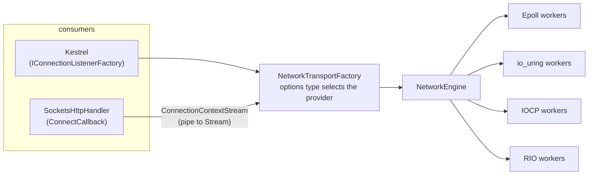
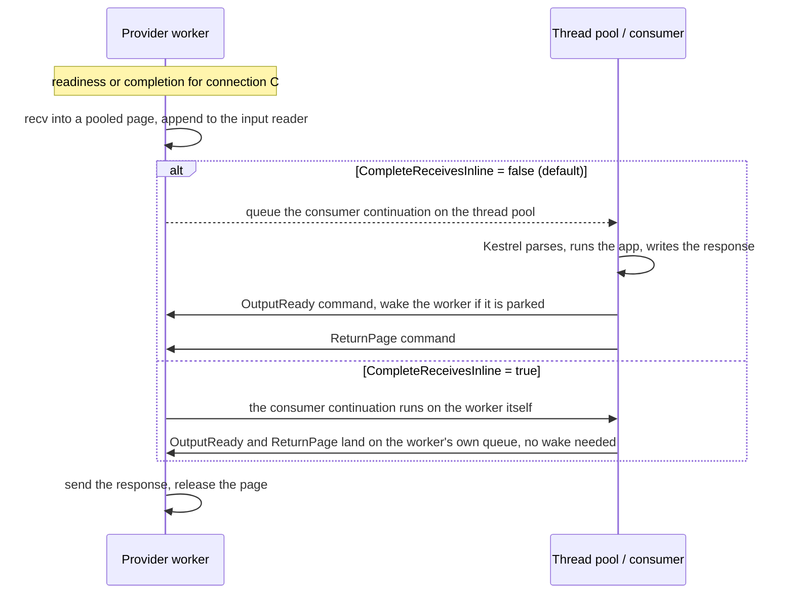

# Project Bedrock: the shared transport behind the Connections abstractions

This document describes the current state of an experiment on branch `dmkorolev/project-bedrock`: the four prototype providers (epoll and io_uring on Linux, IOCP and RIO on Windows) hidden behind the existing `Microsoft.AspNetCore.Connections` interfaces, so that Kestrel can serve through them and `HttpClient` can dial through them, in the spirit of [dotnet/aspnetcore#4772](https://github.com/dotnet/aspnetcore/issues/4772).

It is an experiment and not an API proposal. Everything is non-shipping. All numbers were measured on crank or on one development machine and have **not been independently reproduced**. In every table "% of Sockets" means throughput as a fraction of the `System.Net.Sockets` run in the same table (100% is parity, 120% is 20% more requests per second than Sockets), and "more than Sockets" is always written out.

| Document | What it holds |
| --- | --- |
| This file | Architecture, how it works, the latest results and the final comparison. |
| [Bedrock-API.md](Bedrock-API.md) | Only the public API that Bedrock adds or depends on. |
| [Bedrock-History.md](Bedrock-History.md) | The earlier write-up kept as a record: harness artefacts, pre-allocation findings, dropped experiments, WSL2 and 7950X3D tables. Superseded where it disagrees with this file. |
| [PROTOTYPE.md](PROTOTYPE.md), [PUBLIC-API.md](PUBLIC-API.md) | The provider model and the provider API that Bedrock sits on. |
| [SCALING-RESULTS.md](https://github.com/aspnet/Benchmarks/blob/dmkorolev/networking-proto/src/BenchmarksApps/Networking-Transports/SCALING-RESULTS.md) | The 56-core scaling investigation with raw rows, in the Benchmarks repo. |

## Summary

- **Fit.** One class, `NetworkTransportFactory`, implements `IConnectionListenerFactory`, `IConnectionListenerFactorySelector` and `IConnectionFactory`. Nothing in `Microsoft.AspNetCore.Connections.Abstractions`, Kestrel Core or `System.Net.Http` was changed.
- **Server, 56 cores (gold machines, 1 KB TCP keep-alive, `wrk`).** After the 2026-11-12 fixes epoll, io_uring and RIO are at or above Sockets at every measured worker count, and IOCP is at or below parity: **epoll 123%, 100%, 104% and io_uring 126%, 111%, 102% of Sockets at 4, 8 and 28 workers, RIO 115% and 121% and IOCP 94% and 100% at 4 and 28 workers**. Before the fixes the Linux providers were at 78% (epoll) and 63% (io_uring) of Sockets at 28 workers.
- **The Linux loss was scheduling, not I/O.** Two worker wake-ups per request and a thread-pool hop per receive. Joining wake-ups is now the default. Completing receives on the worker is the opt-in `CompleteReceivesInline`, and with it the same machine gives **epoll 136% and io_uring 146% of Sockets at 28 workers**, and 122% and 131% of a Sockets transport that is also run in its inline mode ([Scheduling](#scheduling-is-the-performance-contract)).
- **Windows has the same lever.** `CompleteReceivesInline` takes RIO from 121% to 154% and IOCP from 100% to 122% of Sockets at 28 workers. It also raises p99 on Windows ([Windows server](#windows-server-56-cores)), which Linux does not show.
- **Client.** `SocketsHttpHandler.ConnectCallback` carries real HTTP/1.1 traffic through all four providers. On small client machines the Bedrock client is ahead of `SocketsHttpHandler` when the client is the limit (epoll 114%, io_uring 119%, RIO 142% of Sockets at 2 cores). At 4 cores, where the server is nearly saturated, the Linux providers converge on parity (101-103%), RIO stays ahead (119%) and IOCP is behind (91%). The `Stream` the handler requires costs one copy; see [`ConnectionContextStream`](#why-connectioncontextstream-exists).
- **What it costs.** Memory (RIO registers its slabs), the loss of the zero-copy lease at the `Stream` boundary, and a scheduling choice that the abstractions have no place for.

## Architecture



### One factory, selected by the options type

`NetworkTransportFactory` takes a `NetworkEngineOptions`. The options type chooses the provider (`EpollEngineOptions`, `IoUringEngineOptions`, `IocpEngineOptions`, `RioEngineOptions`), so there is no separate "transport kind" setting. Registration is one line:

```csharp
builder.Services.AddNetworkTransport(new EpollEngineOptions { WorkerCount = 8 });
```

Kestrel selects a factory per endpoint. `CanBind` accepts an IPv4 `IPEndPoint` (on Linux also only with a non-zero port); IPv6, DNS and Unix endpoints fall through to the next registered factory, normally the default Sockets one. `KestrelServerImpl` reverses the registered factories and `TransportManager.BindAsync` takes the first one whose `CanBind` is true, so the last registration wins. Source: [`NetworkTransportFactory.cs`](src/Bedrock/NetworkTransportFactory.cs).

### Providers

A worker is a dedicated thread that owns a set of connections. All state of a connection is touched only by its worker, and other threads talk to it through a command queue plus a wake-up (an `eventfd` write on Linux, `PostQueuedCompletionStatus` on Windows). PROTOTYPE.md has the full description; this is the part that matters here.

| Provider | I/O model | How a request flows through the worker |
| --- | --- | --- |
| Epoll | Readiness notifications. Each worker has its own `SO_REUSEPORT` listener. | `epoll_wait` reports the socket readable, the worker does a non-blocking `recv` into a pooled page and publishes it. A send is a non-blocking `send` on the worker. |
| io_uring | Submission and completion rings, a multishot accept and a multishot receive that takes pages from a provided-buffer ring. | A completion carries the page the kernel chose. The worker publishes it. Sends are submitted on the ring and batched per loop iteration. |
| IOCP | Overlapped `WSARecv` and `WSASend` with a completion port per worker. | A completion means the page is filled. On the server a zero-byte receive probe avoids holding a page per idle connection. |
| RIO | Registered buffers and one request queue per connection, one completion queue per worker. | A completion means the registered page is filled. No per-operation pinning. |

### Server path

Kestrel sees a `ConnectionContext` whose `Transport` is a `IDuplexPipe` adapter over the native connection ([`KestrelConnectionContext`](src/Shared/KestrelAdapters.cs)):

- **Input.** A worker receives into a pooled page and appends it to the connection's `NetworkInputReader`, which Kestrel reads as a `PipeReader`. The page is leased, not copied. Kestrel advances over it and the page goes back to the worker.
- **Output.** Kestrel writes to a `PipeWriter`. Flushing queues an output-ready command to the worker, which sends the bytes from the pipe's buffers.
- **Native access.** `INetworkConnectionFeature` exposes the `NetworkConnection` itself, for a consumer that wants the retained read lease and the explicit send queue instead of pipes. Kestrel does not use it.

### Client path

`ConnectAsync` resolves a `DnsEndPoint` to the first IPv4 address and connects through the provider (a blocking `connect` on the thread pool, then the socket joins a worker). The connection is wrapped in the same `KestrelConnectionContext`. `NetworkTransportHttpExtensions.UseConnectionFactory` sets `SocketsHttpHandler.ConnectCallback` to dial the factory and hand the handler a `Stream`.

Two client-only behaviours exist because a client is not a server:

- **A byte-budget receive window.** HTTP/1.1 in `SocketsHttpHandler` writes the whole request body before it reads the response, and an echoing server blocks if the client stops receiving. A kernel socket has a receive buffer for this. A native client connection instead keeps receiving until 1 MiB of received bytes is leased and unconsumed (`NETWORKPROTO_CLIENT_LEASE_BYTES`). A server never needs this because Kestrel reads continuously.
- **Adaptive receive blocks.** On Windows the block for the next receive starts at 16 KB and doubles up to 256 KB while receives fill it. Linux clients use 64 KB pages. The IOCP zero-byte probe is off for clients.

#### Why `ConnectionContextStream` exists

`SocketsHttpHandler.ConnectCallback` must return a `Stream`, and that is the only hook `System.Net.Http` offers. [`ConnectionContextStream`](src/Bedrock/ConnectionContextStream.cs) is the internal adapter between the pipe that every `IConnectionFactory` produces and that `Stream`. It is **client-only**: Kestrel reads `ConnectionContext.Transport` directly and never sees it.

The `Stream` shape is a cost, but the cost is one copy and not the abstraction:

- A native provider fills its own pages (RIO and io_uring have to, because the memory is registered or chosen by the kernel). `Stream.ReadAsync(Memory<byte>)` has the caller supply the destination, so the bytes are copied from the leased page into the handler's buffer. `Socket` copies once as well, from the kernel into the caller's buffer, so the extra cost is the lease-then-copy model and the pipe hop, not a second full copy.
- Measured on a raw TCP client (WSL2, [Bedrock-History.md](Bedrock-History.md#the-stream-adapter-at-8-kb-and-64-kb)): the stream is within noise of the pipe at 64 B and 1 KB and 4-9 points lower at 8 KB and 64 KB.
- A stream that skipped the pipe (`NetworkConnectionStream`) was tried on the Windows HTTP client and was not better than the pipe adapter without read-ahead, so removing the pipe hop does not remove the cost. It was dropped.

It cannot be avoided without a runtime change: a `System.Net.Http` hook that accepts an `IConnectionFactory` or a `ConnectionContext`, or a receive that fills a caller-supplied buffer. Both are runtime API proposals and are outside this experiment. Until then the non-native fallback in `UseConnectionFactory` also adds a 1 MiB read-ahead, which a native connection skips.

### Scheduling is the performance contract

Where the consumer's continuation runs decides the performance of a native transport. The pooled-page, one-thread-per-connection-set design makes the syscalls cheap and leaves the rest as hand-offs between threads. Per request, the default (non-inline) server path does this:



The 2026-11-12 investigation ([below](#why-linux-lost-at-28-workers-and-what-fixed-it)) found three costs on this path:

1. **Wake-ups.** Each of the two commands per request used to write the worker's `eventfd`. `NETWORKPROTO_COALESCE` joins a command into a wake that is already pending. It is now **on by default** for servers (it was already on for clients).
2. **The receive hop.** Completing the pending read on the worker means the continuation is queued to the thread pool, which then competes with the I/O workers for the same cores. `NetworkEngineOptions.CompleteReceivesInline` (and the per-connection `NetworkConnection.CompleteReceivesInline`) runs it on the worker instead. It is **off by default**.
3. **The send hop.** An awaited `NetworkConnection.SendAsync` resumes on the thread pool unless `NetworkConnection.CompleteSendsInline` is set. A Kestrel server does not await sends this way; this matters for direct consumers, such as the raw TCP client study.

Inline completion has one rule: the continuation shares the worker with every other connection assigned to it, so a consumer that blocks (synchronous I/O, `.Result`) stalls those connections. That is the same trade-off as `SocketTransportOptions.UnsafePreferInlineScheduling`, which is why it is opt-in. `NetworkInputReader` also completes the pending read outside its internal lock now, so an inline continuation does not run while the lock is held.

Not done: sending directly from the thread that flushes (skipping the `OutputReady` command) in the safe, non-inline mode. It would remove one hand-off without the blocking risk and is the next candidate.

## Results

Environment, method and caveats are repeated per table only where they differ.

### Linux server, 56 cores

Crank profile `aspnet-gold-lin-relay`, runtime `11.0.0-rtm.26480.113`. The application is limited to `W` cores (`--application.cpuSet 0-(W-1)`) with `W` workers, so "4 workers" is four cores of a 56-core machine. `wrk` runs on a separate machine against Kestrel with the Bedrock registration, TCP HTTP/1.1 keep-alive, 1 KB response, 256 connections for 4 and 8 workers and 896 for 28, 15 s measured. Each cell is the mean of **2 repetitions** (they differ by 0.1-5%). Measured on crank, not independently reproduced.

"default" is the shipping configuration of each transport. "inline" is `CompleteReceivesInline = true` for Bedrock and, for the Sockets baseline, `UnsafePreferInlineScheduling = true` plus `DOTNET_SYSTEM_NET_SOCKETS_INLINE_COMPLETIONS=1`, so the inline rows compare like with like.

Requests per second:

| Workers | Sockets default | Sockets inline | epoll default | epoll inline | io_uring default | io_uring inline |
| --- | --- | --- | --- | --- | --- | --- |
| 4 | 311,004 | 436,778 | 383,005 | 534,679 | 392,538 | 592,676 |
| 8 | 539,573 | 763,915 | 539,160 | 868,763 | 598,307 | 985,926 |
| 28 | 1,783,390 | 1,985,162 | 1,857,064 | 2,421,406 | 1,823,048 | 2,599,625 |

% of Sockets default (the configuration people run):

| Workers | epoll default | epoll inline | io_uring default | io_uring inline |
| --- | --- | --- | --- | --- |
| 4 | 123% | 172% | 126% | 191% |
| 8 | 100% | 161% | 111% | 183% |
| 28 | 104% | 136% | 102% | 146% |

% of Sockets inline (the fairest comparison of the two inline paths):

| Workers | epoll inline | io_uring inline |
| --- | --- | --- |
| 4 | 122% | 136% |
| 8 | 114% | 129% |
| 28 | 122% | 131% |

p99 latency (ms, mean of 2): Sockets default 4.0 / 3.4 / 3.4, epoll default 2.9 / 3.5 / 3.6, epoll inline 1.9 / 1.2 / 1.7, io_uring inline 1.3 / 1.0 / 1.3 at 4 / 8 / 28 workers. The p99 of epoll default is not better than Sockets default at 8 and 28 workers, and io_uring default is; inline is better than the matching Sockets row at every worker count.

#### Why Linux lost at 28 workers, and what fixed it

On 2026-11-09 the same machine gave epoll 78% and io_uring 63% of Sockets at 28 workers (1.42M and 1.15M against 1.82M requests per second, [GOLD-RESULTS.md](https://github.com/aspnet/Benchmarks/blob/dmkorolev/networking-proto/src/BenchmarksApps/Networking-Transports/GOLD-RESULTS.md)). The Bedrock adapter was not the cause (the legacy registration gave the same numbers), and pinning the workers made epoll worse. A per-second sampler (`NETWORKPROTO_DIAG=1`: per-thread-group CPU, context switches, run-queue wait, thread-pool items, and epoll syscall counters) gave this single-run picture at 28 workers:

| Configuration (28 workers) | Requests/s | CPU per request | Thread-pool items per request | Worker wake-ups per request | Run-queue wait (cores) |
| --- | --- | --- | --- | --- | --- |
| Sockets default | 1.78M | 15.1 µs | 1.96 | n/a | 2.3 |
| Sockets inline | 1.99M | 13.6 µs | 0 | n/a | 0.2 |
| epoll, wake-ups not joined (the 2026-11-09 build) | 1.41M | 17.7 µs | 0.97 | 2.00 | 18.4 |
| epoll, wake-ups joined (the new default) | 1.83M | 14.6 µs | 0.97 | 0.07 | 17.2 |
| epoll, joined and `CompleteReceivesInline` | 2.41M | 11.2 µs | 0 | 0 | 0.5 |

What the table says:

- **The kernel work is similar.** The epoll threads spend 6.8-7.6 µs of system time per request on `recv` and `send`, and the Sockets thread-pool threads spend 7.9-8.0 µs. Bedrock on epoll does the same syscalls, so it should not be expected to make them cheaper.
- **Un-joined wake-ups cost about 3 µs per request.** Two `eventfd` writes from thread-pool threads per request, plus `epoll_wait` waking per request, moved epoll from 17.7 to 14.6 µs per request once they were joined. Against the Sockets run of the same day that is 79% to 103%.
- **The thread-pool hop is the rest.** In default mode 28 epoll threads and about 40 thread-pool threads share 28 cores, and run-queue wait stays at about 17 cores. Completing on the worker removes the second set of threads and the wait (0.5 cores), and takes CPU per request to 11.2 µs.
- Each row is one run. The default and inline rows are reproduced by the 2-repetition matrix above.

#### The option equals the environment switch

The inline cells came from two builds: repetition 1 used an environment-variable switch inside the transport, and repetition 2 used the public `NetworkEngineOptions.CompleteReceivesInline` (the one exception is the Linux 4-worker epoll cell, whose second repetition still ran the environment-variable build). Repetition 2 is within 0.1-5% of repetition 1 in every inline cell, on Linux and on Windows, so the option behaves like the switch it replaced.

### Windows server, 56 cores

Crank profile `aspnet-gold-win-relay`, same scenario, 4 and 28 workers, `wrk` on a separate Linux machine, mean of 2 repetitions. The Sockets inline row uses `UnsafePreferInlineScheduling`; the environment variable above only applies to the Unix socket engine.

| Workers | Sockets default | Sockets inline | IOCP default | IOCP inline | RIO default | RIO inline |
| --- | --- | --- | --- | --- | --- | --- |
| 4 | 282,432 | 286,678 | 264,980 | 319,230 | 325,964 | 443,623 |
| 28 | 1,411,660 | 1,398,121 | 1,407,002 | 1,717,049 | 1,714,052 | 2,178,596 |

| Workers | IOCP default | IOCP inline | RIO default | RIO inline |
| --- | --- | --- | --- | --- |
| 4 | 94% | 113% | 115% | 157% |
| 28 | 100% | 122% | 121% | 154% |

- At 8 workers the 2026-11-09 run (default configuration, mean of 2) had RIO at 110% and IOCP at 93% of Sockets.
- **p99 is not better with inline on Windows.** At 28 workers p99 is 29.9 ms for Sockets default and 3.3 ms for Sockets inline, 23.0 ms for IOCP default and 52.5 ms for IOCP inline, 21.5 ms for RIO default and 92.1 ms for RIO inline. At 4 workers RIO is 9.1 ms default and 36.5 ms inline. Throughput is higher and the tail is longer; the cause was not investigated.
- Sockets and IOCP default both land at about 1.40M at 28 workers. That is not a limit of the machine, since RIO inline reaches 2.18M on it, and its cause was not investigated.

### Client

The client is `SocketsHttpHandler` with `ConnectCallback` set to a Bedrock factory (`BedrockClient` in the Benchmarks repo), against a plain Kestrel Sockets server on another machine (Linux for both client operating systems), 1 KB responses, so only the client transport changes. Two repetitions per cell unless stated.

**Small machines (idna profiles), 2026-11-12.** Client limited to `W` cores, 128 connections at 2 cores and 256 at 4, 0 errors in all 24 runs. Mean requests per second:

| Machine | Client cores | Sockets | Bedrock client | % of Sockets | Machine CPU (client / server) |
| --- | --- | --- | --- | --- | --- |
| Linux | 2 | 61,614 | epoll 69,973 | 114% | 56% / 71% |
| Linux | 2 | 61,614 | io_uring 73,059 | 119% | 56% / 71% |
| Linux | 4 | 101,955 | epoll 103,475 | 101% | 93% / 88% |
| Linux | 4 | 101,955 | io_uring 104,874 | 103% | 93% / 88% |
| Windows (AMD) | 2 | 51,066 | IOCP 52,500 | 103% | 71% / 64% |
| Windows (AMD) | 2 | 51,066 | RIO 72,397 | 142% | 71% / 64% |
| Windows (AMD) | 4 | 82,650 | IOCP 74,800 | 91% | 90% / 80% |
| Windows (AMD) | 4 | 82,650 | RIO 98,581 | 119% | 90% / 80% |

Reading it: when the client is the limiting side (2 cores) the native clients are ahead. At 4 cores both machines are 80-99% busy and the server limits, so the Linux providers converge on Sockets (101-103%). IOCP loses at 4 cores on Windows (91%), as it does on the server at 4 workers. Sockets at 2 cores on Windows varied between 46.7k and 55.4k, so that cell is noisy. A first Windows run on a different idna machine was discarded because the machine was saturated (1.6-4k requests per second for every handler).

**56-core machines, 2026-11-09** (single run per cell, before the zero-length-read fix below; only 7 of 18 planned runs per OS completed):

| Workers | Linux epoll | Linux io_uring | Windows IOCP | Windows RIO |
| --- | --- | --- | --- | --- |
| 4 | 112.5% | 119.7% | 77.3% | 106.9% |
| 8 | 153.6% | 135.0% | 101.2% | 151.4% |

These are single runs against Sockets cells that moved by 5-10% between runs, so only the direction is reliable. The 28-worker cells did not complete.

**Below HTTP, local runs (WSL2 and Windows on a 7950X3D, 2 client CPUs, a C echo server, 64 connections, 5 repetitions).** With HTTP and Kestrel removed, io_uring was ahead of a plain `Socket` by about 7-16% at 64 B to 8 KB, epoll was at parity (97-107%), RIO was ahead by 6-17% at 64 B and 1 KB, and IOCP was at parity. Nothing beat `Socket` at 64 KB on Windows. The `Stream` adapter cost 4-9 points at 8 KB and 64 KB. An awaited `SendAsync` on a CPU-limited epoll client cost 30% until `CompleteSendsInline` or the queued send path was used. Details are in [Bedrock-History.md](Bedrock-History.md#raw-tcp-client-removing-http-and-kestrel-from-the-picture). These runs predate the scheduling changes above and are local, not crank.

**A bug found on the way.** The earlier 56-core client matrices stopped because non-Sockets handlers sometimes stalled until `HttpClient.Timeout`. `ConnectionContextStream.ReadAsync` handled a zero-length read (which the handler uses to wait for data) by advancing the pipe with `AdvanceTo(Start, End)`, which marks the data examined and makes the following read wait for *new* data. It now calls `AdvanceTo(Start)`. The idna runs above (24 runs, 0 errors) are the first matrices after the fix; they support it but do not prove no other stall exists.

### Earlier results on 4-vCPU crank machines

The original private-factory registration measured +9% to +30% over Sockets on 4-vCPU Intel machines ([LINUX-RESULTS.md](https://github.com/aspnet/Benchmarks/blob/dmkorolev/networking-proto/src/BenchmarksApps/Networking-Transports/LINUX-RESULTS.md), [WINDOWS-RESULTS.md](https://github.com/aspnet/Benchmarks/blob/dmkorolev/networking-proto/src/BenchmarksApps/Networking-Transports/WINDOWS-RESULTS.md)). Those runs used the registration and the wake-up default of that time and have not been repeated with the current defaults. The 4-worker gold result moved in the same direction (epoll 108% before the fixes, 123% after).

## What this shows

- **The abstractions fit.** The server and client sides both fit behind existing interfaces with one class. The Bedrock adapter is not measurably slower than the private factory it replaced.
- **With scheduling fixed, the native providers beat Sockets on a 56-core machine, but the margin depends on one opt-in.** Default: 100-126% (Linux) and 94-121% (Windows) of Sockets. Inline: 136-191% (Linux) and 113-157% (Windows). Against a Sockets run that also uses inline scheduling the Linux margin is 114-136% and the Windows margin 111-156%.
- **Most of what native I/O buys here is the scheduling model, not cheaper syscalls.** The kernel work per request is the same as for Sockets on Linux.
- **The cost is a contract the abstractions lack.** `IConnectionListenerFactory` has no place to say where continuations run, so it lives on the engine options. A public design would have to say it explicitly.
- **The `Stream` boundary is the remaining client cost.** Closing it needs a runtime hook.

## What a real integration would still need

- A `System.Net.Http` hook that accepts an `IConnectionFactory` or a `ConnectionContext`, instead of a callback that returns a `Stream`.
- A client-side counterpart of `CanBind` (a `CanConnect`), IPv6 and a DNS-aware connect with a fallback to the Sockets factory. Today the clients are IPv4 only.
- `ConnectEx` on Windows and a non-blocking connect on Linux instead of a blocking `connect` on the thread pool.
- A decision about worker ownership for clients: a process-wide engine with a few workers, sized by the application.
- A decision about the inline default. It is the largest measured lever and carries a blocking risk, so it is off.
- Measurement on more than one machine type, with more than two repetitions, on bare-metal Linux, and a latency-focused run that explains the Windows inline p99.

## Limits of these measurements

- Crank runs: 2 repetitions per cell for the Linux and Windows server matrices (single-run ranges 0.4-5%), 2 per cell for the idna client matrices, 1 for the 56-core client matrices, and 1 for each diagnostic row. Differences under about 5% are not findings.
- One workload: 1 KB responses, keep-alive TCP, `wrk` on a separate machine. The 56-core results do not cover TLS, larger bodies, or connection churn. TLS was measured earlier only on the Linux server on a development machine ([Bedrock-History.md](Bedrock-History.md)).
- The application is pinned to `W` cores of a 56-core machine; that is not the same as a `W`-core machine (the NIC, the other cores' caches and interrupts are shared).
- The Sockets baseline is the stock runtime on the same build; the inline Sockets baseline relies on `UnsafePreferInlineScheduling` and, on Linux, `DOTNET_SYSTEM_NET_SOCKETS_INLINE_COMPLETIONS`.
- The Windows inline p99 increase is measured but unexplained. CPU per request is not reported for io_uring, because the sampler counts threads that wait in the kernel for completions as busy.
- The memory cost is unchanged from [MemoryFootprint.md](MemoryFootprint.md): RIO registers its slabs and uses 2-3 times the memory of Sockets on a client.
