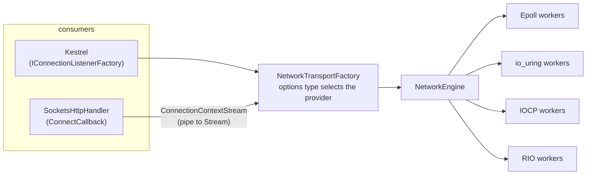
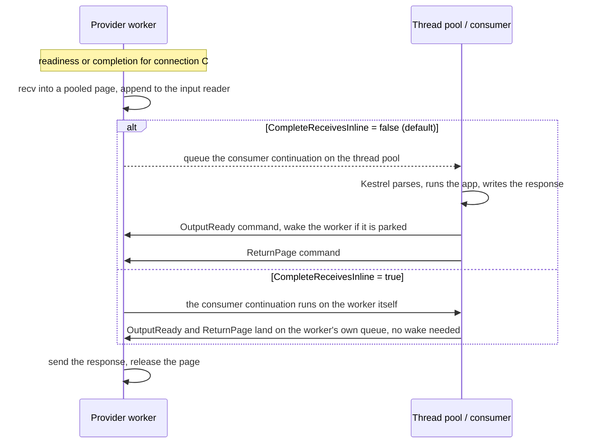

# Project Bedrock: the shared transport behind the Connections abstractions

This document describes the current state of an experiment on branch `dmkorolev/project-bedrock`: the four prototype providers (epoll and io_uring on Linux, IOCP and RIO on Windows) hidden behind the existing `Microsoft.AspNetCore.Connections` interfaces, so that Kestrel can serve through them and `HttpClient` can dial through them, in the spirit of [dotnet/aspnetcore#4772](https://github.com/dotnet/aspnetcore/issues/4772).

It is an experiment and not an API proposal. Everything is non-shipping. All numbers were measured on crank or on one development machine and have **not been independently reproduced**. In every table "% of Sockets" means throughput as a fraction of the `System.Net.Sockets` run in the same table (100% is parity, 120% is 20% more requests per second than Sockets), and "more than Sockets" is always written out.

| Document | What it holds |
| --- | --- |
| This file | Architecture, how it works, the latest results and the final comparison. |
| [Bedrock-API.md](https://github.com/DeagleGross/aspnetcore/blob/dmkorolev/project-bedrock/src/Servers/Kestrel/Transport.Networking/Bedrock-API.md) | Only the public API that Bedrock adds or depends on. |
| [Bedrock-Deep-Dive.md](https://github.com/DeagleGross/aspnetcore/blob/dmkorolev/project-bedrock/src/Servers/Kestrel/Transport.Networking/Bedrock-Deep-Dive.md) | Where each provider does its I/O (the io_uring and RIO queues, the epoll and IOCP reads and writes), how completions return to the thread pool, and what the implementation sweep found, with links into the code. |
| [Bedrock-History.md](https://github.com/DeagleGross/aspnetcore/blob/dmkorolev/project-bedrock/src/Servers/Kestrel/Transport.Networking/Bedrock-History.md) | The earlier write-ups kept as a record: harness artefacts, pre-allocation findings, dropped experiments, the Linux scaling investigation, WSL2 and 7950X3D tables. Superseded where it disagrees with this file. |
| [PROTOTYPE.md](https://github.com/DeagleGross/aspnetcore/blob/dmkorolev/project-bedrock/src/Servers/Kestrel/Transport.Networking/PROTOTYPE.md), [PUBLIC-API.md](https://github.com/DeagleGross/aspnetcore/blob/dmkorolev/project-bedrock/src/Servers/Kestrel/Transport.Networking/PUBLIC-API.md) | The provider model and the provider API that Bedrock sits on. |
| [GOLD-RESULTS.md](https://github.com/aspnet/Benchmarks/blob/dmkorolev/networking-proto/src/BenchmarksApps/Networking-Transports/GOLD-RESULTS.md), [SCALING-RESULTS.md](https://github.com/aspnet/Benchmarks/blob/dmkorolev/networking-proto/src/BenchmarksApps/Networking-Transports/SCALING-RESULTS.md) | The 56-core server and client tables with raw rows, and the CPU-per-request and NIC measurements behind the explanations here (Benchmarks repo). |
| [LINUX-RESULTS.md](https://github.com/aspnet/Benchmarks/blob/dmkorolev/networking-proto/src/BenchmarksApps/Networking-Transports/LINUX-RESULTS.md), [WINDOWS-RESULTS.md](https://github.com/aspnet/Benchmarks/blob/dmkorolev/networking-proto/src/BenchmarksApps/Networking-Transports/WINDOWS-RESULTS.md) | The small-machine results (4-vCPU Intel), including TLS (Benchmarks repo). |

## Summary

- **Fit.** One class, `NetworkTransportFactory`, implements `IConnectionListenerFactory`, `IConnectionListenerFactorySelector` and `IConnectionFactory`. Nothing in `Microsoft.AspNetCore.Connections.Abstractions`, Kestrel Core or `System.Net.Http` was changed.
- **Server, 56-core machines (1 KB TCP keep-alive, `wrk`).** In the default configuration epoll, io_uring and RIO are at or above Sockets at every measured worker count, and IOCP is at or below parity. On Linux epoll is **123%, 100%, 118%, 104% and 108%** and io_uring **126%, 111%, 117%, 102% and 108%** of Sockets at 4, 8, 16, 28 and 56 workers (56 is the whole machine). On Windows RIO is **115% and 121%** and IOCP **94% and 100%** at 4 and 28 workers.
- **Scheduling decides default-mode performance.** Completing receives on the worker is the opt-in `CompleteReceivesInline`. With it the Linux providers reach **epoll 136% and io_uring 146% of Sockets at 28 workers** (122% and 131% of a Sockets transport that is also run in its inline mode), and Windows reaches **RIO 154% and IOCP 122%** ([Scheduling](#scheduling-is-the-performance-contract)). Default mode has a ceiling at many cores: about 8 µs of the 14-15 µs of CPU per request is kernel TCP work that Sockets pays too ([What limits default mode](#what-limits-default-mode)). Part of the shrinking margin on 28 workers is a property of the test: the NIC spreads its receive interrupts over all 56 CPUs, so a cpuset puts some of that work on other CPUs ([The cpuset is not a smaller machine](#the-cpuset-is-not-a-smaller-machine)).
- **Small machines are where the margin is largest.** On a 2-CPU Intel server epoll is 128% and io_uring 148% of Sockets, and on small client machines the Bedrock client is ahead of `SocketsHttpHandler` when the client is the limit (epoll 114%, io_uring 119%, RIO 142% at 2 cores).
- **Client.** `SocketsHttpHandler.ConnectCallback` carries real HTTP/1.1 traffic through all four providers. At 4 cores, where the server is nearly saturated, the Linux providers converge on parity (101-103%), RIO stays ahead (119%) and IOCP is behind (91%). The `Stream` the handler requires costs one copy in each direction; see [`ConnectionContextStream`](#why-connectioncontextstream-exists).
- **What it costs.** Memory (RIO registers its slabs), the loss of the zero-copy lease at the `Stream` boundary, about 250 B of allocation per request on Linux (Sockets: 2 B), and a scheduling choice that the abstractions have no place for.

## Architecture



### One factory, selected by the options type

`NetworkTransportFactory` takes a `NetworkEngineOptions`. The options type chooses the provider (`EpollEngineOptions`, `IoUringEngineOptions`, `IocpEngineOptions`, `RioEngineOptions`), so there is no separate "transport kind" setting. Registration is one line:

```csharp
builder.Services.AddNetworkTransport(new EpollEngineOptions { WorkerCount = 8 });
```

Kestrel selects a factory per endpoint. `CanBind` accepts an IPv4 `IPEndPoint` (on Linux also only with a non-zero port); IPv6, DNS and Unix endpoints fall through to the next registered factory, normally the default Sockets one. `KestrelServerImpl` reverses the registered factories and `TransportManager.BindAsync` takes the first one whose `CanBind` is true, so the last registration wins. Source: [`NetworkTransportFactory.cs`](https://github.com/DeagleGross/aspnetcore/blob/dmkorolev/project-bedrock/src/Servers/Kestrel/Transport.Networking/src/Bedrock/NetworkTransportFactory.cs).

### Providers

A worker is a dedicated thread that owns a set of connections. All state of a connection is touched only by its worker, and other threads talk to it through a command queue plus a wake-up (an `eventfd` write on Linux, `PostQueuedCompletionStatus` on Windows). [PROTOTYPE.md](https://github.com/DeagleGross/aspnetcore/blob/dmkorolev/project-bedrock/src/Servers/Kestrel/Transport.Networking/PROTOTYPE.md) has the full description, and [Bedrock-Deep-Dive.md](https://github.com/DeagleGross/aspnetcore/blob/dmkorolev/project-bedrock/src/Servers/Kestrel/Transport.Networking/Bedrock-Deep-Dive.md) links the main pieces of each provider in the code; this is the part that matters here.

| Provider | I/O model | How a request flows through the worker |
| --- | --- | --- |
| Epoll | Readiness notifications. Each worker has its own `SO_REUSEPORT` listener. | `epoll_wait` reports the socket readable, the worker does a non-blocking `recv` into a pooled page and publishes it. A send is a non-blocking `send` on the worker. |
| io_uring | Submission and completion rings, a multishot accept and a multishot receive that takes pages from a provided-buffer ring. | A completion carries the page the kernel chose. The worker publishes it. Sends are submitted on the ring and batched per loop iteration. |
| IOCP | Overlapped `WSARecv` and `WSASend` with a completion port per worker. | A completion means the page is filled. On the server a zero-byte receive probe avoids holding a page per idle connection. |
| RIO | Registered buffers and one request queue per connection, one completion queue per worker. | A completion means the registered page is filled. No per-operation pinning. |

### Server path

Kestrel sees a `ConnectionContext` whose `Transport` is a `IDuplexPipe` adapter over the native connection ([`KestrelConnectionContext`](https://github.com/DeagleGross/aspnetcore/blob/dmkorolev/project-bedrock/src/Servers/Kestrel/Transport.Networking/src/Shared/KestrelAdapters.cs)):

- **Input.** A worker receives into a pooled page and appends it to the connection's `NetworkInputReader`, which Kestrel reads as a `PipeReader`. The page is leased, not copied. Kestrel advances over it and the page goes back to the worker.
- **Output.** Kestrel writes to a `PipeWriter`. Flushing queues an output-ready command to the worker, which sends the bytes from the pipe's buffers.
- **Native access.** `INetworkConnectionFeature` exposes the `NetworkConnection` itself, for a consumer that wants the retained read lease and the explicit send queue instead of pipes. Kestrel does not use it.

### Client path

`ConnectAsync` resolves a `DnsEndPoint` to the first IPv4 address and connects through the provider (a blocking `connect` on the thread pool, then the socket joins a worker). The connection is wrapped in the same `KestrelConnectionContext`. `NetworkTransportHttpExtensions.UseConnectionFactory` sets `SocketsHttpHandler.ConnectCallback` to dial the factory and hand the handler a `Stream`.

Two client-only behaviours exist because a client is not a server:

- **A byte-budget receive window.** HTTP/1.1 in `SocketsHttpHandler` writes the whole request body before it reads the response, and an echoing server blocks if the client stops receiving. A kernel socket has a receive buffer for this. A native client connection instead keeps receiving until 1 MiB of received bytes is leased and unconsumed (`NETWORKPROTO_CLIENT_LEASE_BYTES`). A server never needs this because Kestrel reads continuously.
- **Adaptive receive blocks.** On Windows the block for the next receive starts at 16 KB and doubles up to 256 KB while receives fill it. Linux clients use 64 KB pages. The IOCP zero-byte probe is off for clients.

#### Why `ConnectionContextStream` exists

`SocketsHttpHandler.ConnectCallback` must return a `Stream`, and that is the only hook `System.Net.Http` offers. [`ConnectionContextStream`](https://github.com/DeagleGross/aspnetcore/blob/dmkorolev/project-bedrock/src/Servers/Kestrel/Transport.Networking/src/Bedrock/ConnectionContextStream.cs) is the internal adapter between the pipe that every `IConnectionFactory` produces and that `Stream`. It is **client-only**: Kestrel reads `ConnectionContext.Transport` directly and never sees it.

The `Stream` shape is a cost, but the cost is a copy per direction and not the abstraction:

- A native provider fills its own pages (RIO and io_uring have to, because the memory is registered or chosen by the kernel). `Stream.ReadAsync(Memory<byte>)` has the caller supply the destination, so the bytes are copied from the leased page into the handler's buffer, and `Stream.WriteAsync(ReadOnlyMemory<byte>)` copies the handler's bytes into an output block that the provider then sends ([`ReadAsync`](https://github.com/DeagleGross/aspnetcore/blob/dmkorolev/project-bedrock/src/Servers/Kestrel/Transport.Networking/src/Bedrock/ConnectionContextStream.cs#L83), [`WriteAsync`](https://github.com/DeagleGross/aspnetcore/blob/dmkorolev/project-bedrock/src/Servers/Kestrel/Transport.Networking/src/Bedrock/ConnectionContextStream.cs#L103)). `Socket` has no user-space copy: the kernel copies directly between the socket and the caller's buffer. So the extra cost is one user-space copy per direction plus the pipe hop, on top of the same single kernel copy.
- Measured on a raw TCP client (WSL2, [Bedrock-History.md](https://github.com/DeagleGross/aspnetcore/blob/dmkorolev/project-bedrock/src/Servers/Kestrel/Transport.Networking/Bedrock-History.md#the-stream-adapter-at-8-kb-and-64-kb)): the stream is within noise of the pipe at 64 B and 1 KB and 4-9 points lower at 8 KB and 64 KB.
- A stream that skipped the pipe (`NetworkConnectionStream`) was tried on the Windows HTTP client and was not better than the pipe adapter without read-ahead, so removing the pipe hop does not remove the cost. It was dropped.

It cannot be avoided without a runtime change: a `System.Net.Http` hook that accepts an `IConnectionFactory` or a `ConnectionContext`, or a receive that fills a caller-supplied buffer. Both are runtime API proposals and are outside this experiment. Until then the non-native fallback in `UseConnectionFactory` also adds a 1 MiB read-ahead, which a native connection skips. A zero-length read, which the handler uses to wait for data, leaves the received bytes unexamined (`AdvanceTo(Start)`), so the read that follows returns them instead of waiting for more.

### Pages, receive and send on a connection

The provider owns the memory on both sides and the consumer borrows it. [Bedrock-Deep-Dive.md](https://github.com/DeagleGross/aspnetcore/blob/dmkorolev/project-bedrock/src/Servers/Kestrel/Transport.Networking/Bedrock-Deep-Dive.md#pages-receive-and-send-on-a-connection) has the code for all of this with links, and [PROTOTYPE.md](https://github.com/DeagleGross/aspnetcore/blob/dmkorolev/project-bedrock/src/Servers/Kestrel/Transport.Networking/PROTOTYPE.md#pages) describes the provider API.

| Provider | Receive pages (server) | Output blocks |
| --- | --- | --- |
| epoll | 2048 pinned 16 KiB pages per worker, filled by one `recv` on the worker | Per-worker native pool, first block 4 KiB, up to 256 KiB |
| io_uring | 2048 pinned 16 KiB pages given to a provided-buffer ring, the kernel picks the page when data arrives | The same |
| IOCP | A 16 KiB block leased from a native pool just before each `WSARecv` | Native pool, first block 64 KiB, up to 256 KiB |
| RIO | The same, from slabs registered with `RIORegisterBuffer` | Registered pool, first block 64 KiB, up to 1 MiB |

- **Receive.** The provider fills a page and publishes it. `NetworkInputReader` links the pages into the `ReadOnlySequence<byte>` that Kestrel parses in place, `AdvanceTo` releases every page that was consumed completely, and the last reference to a page sends a `ReturnPage` command to the worker that owns it. The pages are never copied. A page that a consumer retains stays leased until it is disposed.
- **Backpressure.** A server connection may hold 4 unreleased pages (64 KiB). At the limit it stops reading until a page returns: epoll drops `EPOLLIN` so the kernel buffer fills, io_uring cancels the multishot receive and arms a new one, and Windows posts no receive. A client budgets by bytes instead (1 MiB leased). When a whole worker's pool runs dry, epoll and Windows pause the connections until pages return, while an io_uring receive completes with `ENOBUFS` and is armed again at once.
- **Send.** Kestrel writes into an output pipe whose blocks come from the provider's native pool, so the bytes it writes are the bytes that get sent. `FlushAsync` queues an `OutputReady` command, and the worker sends one block per native operation and submits the next only after the previous one completes. Because one block is one send, an adaptive pool learns the block size per connection and per worker (a response that fits in the first block is one send). Direct `SendAsync` and `EnqueueSend` are an alternative mode that Kestrel does not use, with a 1 MiB admission limit.
- **RIO** sends only from registered memory. Kestrel's blocks are registered, so it never copies, but a direct `SendAsync` of unregistered caller memory is first copied into a registered block.
- **Copies.** None on the Kestrel path. The client's `ConnectionContextStream` adds one copy per direction (see above).

### Scheduling is the performance contract

Where the consumer's continuation runs decides the performance of a native transport. The pooled-page, one-thread-per-connection-set design makes the syscalls cheap and leaves the rest as hand-offs between threads. Per request, the default (non-inline) server path does this:



Three costs are on this path:

1. **Wake-ups.** Each of the two commands per request wakes the worker through its `eventfd` unless a wake is already pending, in which case the command joins it (`NETWORKPROTO_COALESCE=0` restores one wake per command). That leaves about 0.07 wake-ups per request on epoll.
2. **The receive hop.** Completing the pending read on the worker means the continuation is queued to the thread pool, which then competes with the I/O workers for the same cores. `NetworkEngineOptions.CompleteReceivesInline` (and the per-connection `NetworkConnection.CompleteReceivesInline`) runs it on the worker instead. It is **off by default**.
3. **The send hop.** An awaited `NetworkConnection.SendAsync` resumes on the thread pool unless `NetworkConnection.CompleteSendsInline` is set. A Kestrel server does not await sends this way; this matters for direct consumers, such as the raw TCP client study.

Inline completion has one rule: the continuation shares the worker with every other connection assigned to it, so a consumer that blocks (synchronous I/O, `.Result`) stalls those connections. That is the same trade-off as `SocketTransportOptions.UnsafePreferInlineScheduling`, which is why it is opt-in. `NetworkInputReader` completes the pending read outside its internal lock, so an inline continuation does not run while the lock is held.

Moving the send or the receive to another thread instead (the thread that flushes also sends; `recv` on a thread-pool thread) was slower than leaving the worker in charge ([Bedrock-History.md](https://github.com/DeagleGross/aspnetcore/blob/dmkorolev/project-bedrock/src/Servers/Kestrel/Transport.Networking/Bedrock-History.md#three-attempts-to-raise-default-mode-that-did-not-work)).

## Results

Environment, method and caveats are repeated per table only where they differ.

### Linux server, 56 cores

Crank profile `aspnet-gold-lin-relay`, runtime `11.0.0-rtm.26480.113`. The application is limited to `W` cores (`--application.cpuSet 0-(W-1)`) with `W` workers, so "4 workers" is four cores of a 56-core machine, and 56 workers is the whole machine. `wrk` runs on a separate machine against Kestrel with the Bedrock registration, TCP HTTP/1.1 keep-alive, 1 KB response, 256 connections for 4 and 8 workers, 576 for 16, 896 for 28 and 1,792 for 56, 15 s measured. The 4, 8 and 28 worker cells are the mean of **2 repetitions** (they differ by 0.1-5%); the 16 and 56 worker cells are **single runs**. Measured on crank, not independently reproduced.

"default" is the shipping configuration of each transport. "inline" is `CompleteReceivesInline = true` for Bedrock and, for the Sockets baseline, `UnsafePreferInlineScheduling = true` plus `DOTNET_SYSTEM_NET_SOCKETS_INLINE_COMPLETIONS=1`, so the inline rows compare like with like. A dash is a cell that was not run.

Requests per second:

| Workers | Sockets default | Sockets inline | epoll default | epoll inline | io_uring default | io_uring inline |
| --- | --- | --- | --- | --- | --- | --- |
| 4 | 311,004 | 436,778 | 383,005 | 534,679 | 392,538 | 592,676 |
| 8 | 539,573 | 763,915 | 539,160 | 868,763 | 598,307 | 985,926 |
| 16 | 1,007,239 | 1,342,160 | 1,184,912 | - | 1,181,887 | 1,750,669 |
| 28 | 1,783,390 | 1,985,162 | 1,857,064 | 2,421,406 | 1,823,048 | 2,599,625 |
| 56 | 2,222,302 | - | 2,403,503 | - | 2,398,586 | - |

% of Sockets default (the configuration people run):

| Workers | epoll default | epoll inline | io_uring default | io_uring inline |
| --- | --- | --- | --- | --- |
| 4 | 123% | 172% | 126% | 191% |
| 8 | 100% | 161% | 111% | 183% |
| 16 | 118% | - | 117% | 174% |
| 28 | 104% | 136% | 102% | 146% |
| 56 | 108% | - | 108% | - |

% of Sockets inline (the fairest comparison of the inline paths):

| Workers | epoll inline | io_uring inline |
| --- | --- | --- |
| 4 | 122% | 136% |
| 8 | 114% | 129% |
| 16 | - | 130% |
| 28 | 122% | 131% |

p99 latency (ms) at 4 / 8 / 28 workers (mean of 2): Sockets default 4.0 / 3.4 / 3.4, epoll default 2.9 / 3.5 / 3.6, epoll inline 1.9 / 1.2 / 1.7, io_uring default 2.8 / 2.0 / 2.8, io_uring inline 1.3 / 1.0 / 1.3. At 16 workers (1 run): Sockets 3.3, Sockets inline 1.9, epoll 3.7, io_uring 2.8, io_uring inline 1.3. At 56 workers (1 run): Sockets 3.3, epoll 4.1, io_uring 4.2. Inline is better than the matching Sockets row at every worker count, and default-mode epoll is not better than Sockets default at 8 workers and above.

CPU per request of the whole process (µs, single sampler runs, `NETWORKPROTO_DIAG=1`, steady window of about 27 s):

| Workers | Sockets default | Sockets inline | epoll default | epoll inline | io_uring default | io_uring inline |
| --- | --- | --- | --- | --- | --- | --- |
| 16 | 14.8 | 11.5 | 12.4 | - | 11.5 | 8.9 |
| 28 | 15.1 | 13.6 | 14.6 | 11.2 | 14.5 | 10.3 |
| 56 (two threads per core) | 22.6 | - | 21.7 | - | 21.4 | - |

Thread-pool work items per request: 1.9-2.0 for Sockets default, 0.8-1.05 for the Bedrock providers in default mode, 0 for every inline row. Bedrock therefore does not hop to the thread pool more often than Sockets does.

#### What limits default mode

Every transport in default mode is CPU-bound at 14-15 µs per request at 28 workers. Per request (single runs, 28 workers):

| | Sockets default | epoll default | epoll inline |
| --- | --- | --- | --- |
| System time (`recv`, `send`, `epoll_wait`) | 8.4 µs | 8.1 µs | 7.6 µs |
| User time | 6.9 µs | 6.6 µs | 3.6 µs |
| Soft-interrupt share of the cores | 17% | 19% | 23% |

- **About 8 µs per request is kernel TCP work, and it is the same for all transports.** The epoll threads spend 6.8-7.6 µs of system time per request on `recv` and `send`, and the Sockets thread-pool threads 7.9-8.0 µs, so Bedrock should not be expected to make the syscalls cheaper. It moves into soft interrupts as the core count grows (3% of the cores at 4 workers, 17-23% at 28), which is why the native margin shrinks from 123-126% at 4 workers to 102-104% at 28.
- **The consumer's thread-pool hop costs Bedrock about 3.5 µs per request** (14.7 µs in default mode against 11.2 µs inline, almost all of it user time) and Sockets about 1.5 µs (15.3 against 13.8 µs). The likely cause is cache locality: with the hop, the connection's state is touched by a different core on each request. This was not profiled.
- **Keep-alive is already the best case for a transport.** It saves nothing on connect and accept. `Connection: close` is not measurable with this load generator.
- **Both Linux providers already batch.** io_uring uses one ring per worker with `SINGLE_ISSUER` and `DEFER_TASKRUN` and a multishot receive from a provided buffer ring. epoll does 0.14 `epoll_wait` calls and 1.07 events per request, which is about 7.6 events per wait in default mode (about 17 inline), so there is little batching left to win in a request/response workload.
- **Allocation is a smaller cost.** Bedrock allocates about 250 B per request on Linux (Sockets default: 2 B), and the GC pauses cost 2.4-2.8% of the time at 28 workers. Pooling the three per-receive objects (the page lease, the buffer storage and the input segment) would recover part of that, probably 1-2%, and was not done.
- **The 136-146% figures need the consumer to run on the worker.**

#### The cpuset is not a smaller machine

Every Linux row above limits the application to the first `W` CPUs of the machine with `--application.cpuSet`, and the load generator then talks to the same NIC. That NIC (Mellanox mlx5, 40 Gbit/s) has 56 receive queues, and `/proc/irq/*/smp_affinity_list` shows one interrupt per queue, each on a different single CPU covering 0-55 exactly once. So a cpuset of `W` CPUs contains only `W` of the 56 queues' interrupts and the rest of the receive softirq work runs on CPUs the process may not use. The sampler (CPUs outside the cpuset and `NET_RX` counts from `/proc/softirqs`) measured it. Single runs, 1 KB keep-alive, measured on crank and not independently reproduced ([recheck-sampler.txt](https://github.com/aspnet/Benchmarks/blob/dmkorolev/networking-proto/src/BenchmarksApps/Networking-Transports/results/scaling-2026-11-12/recheck-sampler.txt), [recheck-linux.csv](https://github.com/aspnet/Benchmarks/blob/dmkorolev/networking-proto/src/BenchmarksApps/Networking-Transports/results/scaling-2026-11-12/recheck-linux.csv)):

| Workers | CPUs the process may use | `NET_RX` events handled outside them | Soft-interrupt CPU per request on the outside CPUs | epoll default | io_uring default |
| --- | --- | --- | --- | --- | --- |
| 4 | 4 of 56 | not sampled (about 93% by the queue layout) | not sampled | 123% | 126% |
| 16 | 16 of 56 | 62-67% | 1.5-1.6 µs | 118% | 117% |
| 28 | 28 of 56 (one SMT thread of each core) | 49% | 1.7-2.0 µs, on idle SMT siblings of the busy cores | 104% | 102% |
| 56 | the whole machine | 0% | none | 108% | 108% |

- **The small-cpuset margins are helped by work the application does not pay for.** At 4 and 16 workers most of the receive processing happens on CPUs that are not in the cpuset, so the transport's user-space saving is a larger share of what the application's CPUs do. A real 4-core machine would not have that.
- **The 28-worker cpuset is the least favorable layout.** All 28 CPUs are one SMT thread of a physical core, and the other 28 CPUs (the siblings) are idle apart from about 12% softirq, so half the receive work runs on the siblings of busy cores. Total soft-interrupt CPU per request is higher there (about 4.75 µs against about 3.2 µs at 16 workers), and io_uring's per-request CPU rises from 11.5 µs (16 workers) to 14.5 µs (28) while Sockets stays at about 15 µs. SMT contention between the busy cores and the softirq on their siblings is a possible cause; it was not isolated.
- **The whole machine is the honest big-machine number.** At 56 workers all 56 CPUs are 92-98% busy, the interrupts land on the application's CPUs, and epoll and io_uring reach 2.40M requests per second against 2.22M for Sockets (108%; one run each, and run-to-run differences in this matrix are up to 5%). Per-request CPU is 21.4-21.7 µs against 22.6 µs, which is not comparable with the other rows because each core runs two threads.
- **The client is not the limit in default mode.** The same load machine reached 2.40-2.63M requests per second against inline transports; in default mode it was at 34-41% of its logical CPUs at 16 workers, 57-61% at 28 and 69-76% at 56. Inline at 28 workers puts it at 82%, which is close to what an SMT machine can give, so inline figures at 28 workers and above may be partly client-limited. A client limit is not proven away, only not indicated.

### Linux server, 2-CPU Intel machine

`idna-intel-lin-relay`, the application limited to 2 CPUs with 2 workers, 256 connections, 1 KB TCP keep-alive, 2 runs per cell, the application CPUs saturated (about 198%) and the load machine at 66-76%. Measured on crank, not independently reproduced.

| Transport | Requests per second (run 1, run 2) | Mean | % of Sockets | CPU per request |
| --- | --- | --- | --- | --- |
| Sockets | 67,969, 65,315 | 66.6K | 100% | 30.6 µs |
| epoll | 81,411, 89,094 | 85.3K | 128% | 23.0 µs |
| io_uring | 97,704, 99,670 | 98.7K | 148% | 20.3 µs |

Most of the difference is system time per request (11.1 µs for io_uring, 15.8 µs for Sockets), and its cause was not isolated. The same machines with the original registration, TCP and TLS, 1, 8 and 64 KB, are in [LINUX-RESULTS.md](https://github.com/aspnet/Benchmarks/blob/dmkorolev/networking-proto/src/BenchmarksApps/Networking-Transports/LINUX-RESULTS.md).

### Windows server, 56 cores

Crank profile `aspnet-gold-win-relay`, same scenario, 4 and 28 workers, `wrk` on a separate Linux machine, mean of 2 repetitions. The Sockets inline row uses `UnsafePreferInlineScheduling`; the environment variable above only applies to the Unix socket engine.

| Workers | Sockets default | Sockets inline | IOCP default | IOCP inline | RIO default | RIO inline |
| --- | --- | --- | --- | --- | --- | --- |
| 4 | 282,432 | 286,678 | 264,980 | 319,230 | 325,964 | 443,623 |
| 28 | 1,411,660 | 1,398,121 | 1,407,002 | 1,717,049 | 1,714,052 | 2,178,596 |

| Workers | IOCP default | IOCP inline | RIO default | RIO inline |
| --- | --- | --- | --- | --- |
| 4 | 94% | 113% | 115% | 157% |
| 28 | 100% | 122% | 121% | 154% |

- **p99 is not better with inline on Windows.** At 28 workers p99 is 29.9 ms for Sockets default and 3.3 ms for Sockets inline, 23.0 ms for IOCP default and 52.5 ms for IOCP inline, 21.5 ms for RIO default and 92.1 ms for RIO inline. At 4 workers RIO is 9.1 ms default and 36.5 ms inline. Throughput is higher and the tail is longer; the cause was not investigated.
- Sockets and IOCP default both land at about 1.40M at 28 workers. That is not a limit of the machine, since RIO inline reaches 2.18M on it, and its cause was not investigated.

### Client

The client is `SocketsHttpHandler` with `ConnectCallback` set to a Bedrock factory (`BedrockClient` in the Benchmarks repo), against a plain Kestrel Sockets server on another machine (Linux for both client operating systems), 1 KB responses, so only the client transport changes. Two repetitions per cell unless stated.

**Small machines (idna profiles).** Client limited to `W` cores, 128 connections at 2 cores and 256 at 4, 0 errors in all 24 runs. Mean requests per second:

| Machine | Client cores | Sockets | Bedrock client | % of Sockets | Machine CPU (client / server) |
| --- | --- | --- | --- | --- | --- |
| Linux | 2 | 61,614 | epoll 69,973 | 114% | 55% / 66% |
| Linux | 2 | 61,614 | io_uring 73,059 | 119% | 53% / 69% |
| Linux | 4 | 101,955 | epoll 103,475 | 101% | 89% / 84% |
| Linux | 4 | 101,955 | io_uring 104,874 | 103% | 88% / 88% |
| Windows (AMD) | 2 | 51,066 | IOCP 52,500 | 103% | 69% / 65% |
| Windows (AMD) | 2 | 51,066 | RIO 72,397 | 142% | 73% / 65% |
| Windows (AMD) | 4 | 82,650 | IOCP 74,800 | 91% | 99% / 73% |
| Windows (AMD) | 4 | 82,650 | RIO 98,581 | 119% | 98% / 82% |

Reading it: when the client is the limiting side (2 cores) the native clients are ahead. At 4 cores both machines are 80-99% busy and the server limits, so the Linux providers converge on Sockets (101-103%). IOCP loses at 4 cores on Windows (91%), as it does on the server at 4 workers. Sockets at 2 cores on Windows varied between 46.7k and 55.4k, so that cell is noisy.

**56-core machines** (single run per cell; only 7 of 18 planned runs per OS completed, and the 28-worker cells did not):

| Workers | Linux epoll | Linux io_uring | Windows IOCP | Windows RIO |
| --- | --- | --- | --- | --- |
| 4 | 112.5% | 119.7% | 77.3% | 106.9% |
| 8 | 153.6% | 135.0% | 101.2% | 151.4% |

These are single runs against Sockets cells that moved by 5-10% between runs, so only the direction is reliable. They were measured before the zero-length-read handling described under [`ConnectionContextStream`](#why-connectioncontextstream-exists) and were not repeated.

**Below HTTP, local runs** (WSL2 and Windows on a 7950X3D, 2 client CPUs, a C echo server, 64 connections, 5 repetitions). With HTTP and Kestrel removed, io_uring was ahead of a plain `Socket` by about 7-16% at 64 B to 8 KB, epoll was at parity (97-107%), RIO was ahead by 6-17% at 64 B and 1 KB, and IOCP was at parity. Nothing beat `Socket` at 64 KB on Windows. The `Stream` adapter cost 4-9 points at 8 KB and 64 KB. An awaited `SendAsync` on a CPU-limited epoll client cost 30% until `CompleteSendsInline` or the queued send path was used. Details are in [Bedrock-History.md](https://github.com/DeagleGross/aspnetcore/blob/dmkorolev/project-bedrock/src/Servers/Kestrel/Transport.Networking/Bedrock-History.md#raw-tcp-client-removing-http-and-kestrel-from-the-picture). These runs are local, not crank.

## What this shows

- **The abstractions fit.** The server and client sides both fit behind existing interfaces with one class. The Bedrock adapter is not measurably slower than the private factory it replaced.
- **The native providers beat Sockets on 56-core and small machines, but the size of the margin depends on one opt-in.** Default: 100-126% (Linux) and 94-121% (Windows) of Sockets on a cpuset of the machine, 108% on the whole Linux machine, and 128-148% on a 2-CPU Intel server. Inline: 136-191% (Linux) and 113-157% (Windows). Against a Sockets run that also uses inline scheduling the Linux margin is 114-136% and the Windows margin 111-156%.
- **Most of what native I/O buys here is the scheduling model, not cheaper syscalls.** The kernel work per request is the same as for Sockets on Linux.
- **The cost is a contract the abstractions lack.** `IConnectionListenerFactory` has no place to say where continuations run, so it lives on the engine options. A public design would have to say it explicitly.
- **The `Stream` boundary is the remaining client cost.** Closing it needs a runtime hook.

## What a real integration would still need

- A `System.Net.Http` hook that accepts an `IConnectionFactory` or a `ConnectionContext`, instead of a callback that returns a `Stream`.
- A client-side counterpart of `CanBind` (a `CanConnect`), IPv6 and a DNS-aware connect with a fallback to the Sockets factory. Today the clients are IPv4 only.
- `ConnectEx` on Windows and a non-blocking connect on Linux instead of a blocking `connect` on the thread pool.
- A decision about worker ownership for clients: a process-wide engine with a few workers, sized by the application.
- A decision about the inline default. It is the largest measured lever and carries a blocking risk, so it is off.
- Measurement on more than one machine type, with more than two repetitions, on bare-metal Linux, and a latency-focused run that explains the Windows inline p99.

Optimizations that were not tried, none of which changes the contract: pooling the per-receive allocations (about 1-2%), one thread-pool item per batch of completions instead of one per read, and steering each connection to the worker whose CPU receives its queue's interrupt (`SO_INCOMING_CPU`). An io_uring engine inside the runtime thread pool, instead of in a transport, exists in a fork of the runtime ([Bedrock-History.md](https://github.com/DeagleGross/aspnetcore/blob/dmkorolev/project-bedrock/src/Servers/Kestrel/Transport.Networking/Bedrock-History.md#other-io_uring-work-looked-at)).

## Limits of these measurements

- Crank runs: 2 repetitions per cell for the 4, 8 and 28 worker Linux server cells and the Windows server matrix (single-run ranges 0.4-5%), 1 for the 16 and 56 worker Linux cells, 2 per cell for the idna server and client matrices, 1 for the 56-core client matrices, and 1 for each CPU-per-request row. Differences under about 5% are not findings.
- One workload: 1 KB responses, keep-alive TCP, `wrk` on a separate machine. The 56-core results do not cover TLS, larger bodies, or connection churn. TLS was measured on the small crank machines with the original registration ([LINUX-RESULTS.md](https://github.com/aspnet/Benchmarks/blob/dmkorolev/networking-proto/src/BenchmarksApps/Networking-Transports/LINUX-RESULTS.md), [WINDOWS-RESULTS.md](https://github.com/aspnet/Benchmarks/blob/dmkorolev/networking-proto/src/BenchmarksApps/Networking-Transports/WINDOWS-RESULTS.md)) and on a development machine through Bedrock ([Bedrock-History.md](https://github.com/DeagleGross/aspnetcore/blob/dmkorolev/project-bedrock/src/Servers/Kestrel/Transport.Networking/Bedrock-History.md)).
- The application is pinned to `W` cores of a 56-core machine; that is not the same as a `W`-core machine. The NIC's 56 receive interrupts are spread over every CPU, so a cpuset leaves part of the receive work on other CPUs ([The cpuset is not a smaller machine](#the-cpuset-is-not-a-smaller-machine)).
- The Sockets baseline is the stock runtime on the same build; the inline Sockets baseline relies on `UnsafePreferInlineScheduling` and, on Linux, `DOTNET_SYSTEM_NET_SOCKETS_INLINE_COMPLETIONS`.
- The load machine of the 56-core Linux runs has SMT, so its logical CPU use understates its physical limit. Inline rows at 28 workers and above may be partly client-limited.
- The Windows inline p99 increase is measured but unexplained. The CPU-per-request figures come from single sampler runs (`NETWORKPROTO_DIAG=1`) and are not reported for Windows.
- The memory cost is unchanged from [MemoryFootprint.md](https://github.com/DeagleGross/aspnetcore/blob/dmkorolev/project-bedrock/src/Servers/Kestrel/Transport.Networking/MemoryFootprint.md): RIO registers its slabs and uses 2-3 times the memory of Sockets on a client.
